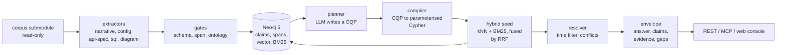

<div align="center">
  
</div>

# Ety&T

<p align="center"><b>Etymology &amp; Translation</b></p>

<p align="center">Answers questions about an engineering repository from dated, status-labelled claims, each traced to the file and line it came from.</p>

[](LICENSE)
[](apps/context-service/pyproject.toml)
[](apps/context-service/tests)
[](infra/neo4j/compose.yaml)
[](#try-it)

## What it does

Ety&T reads a corpus of engineering documents and turns it into a graph of claims. The corpus is
the kind a long-lived repository accumulates: architecture decision records (ADRs), wiki pages,
release notes, incident reports, issue trackers, OpenAPI and GraphQL specifications, SQL
migrations, build configuration and diagram images.

A claim is one assertion made by one document: a subject, a predicate, an object, the dates the
assertion holds for, a status, a confidence score, and a citation down to `path:line` or an image
region. Status is one of `VALID`, `DEPRECATED`, `DISPUTED`, `PLANNED`, `PROPOSED`, `UNKNOWN`.

Questions run against claims, not raw text. Candidate claims come from a vector index and a BM25
index, fused by reciprocal rank fusion, then filtered by the `as_of` date and resolved for
conflicts. The response is an envelope with the answer, the ranked claims, the evidence behind
each one, and the gaps that stopped a fuller answer.

The reason for the claim unit is that similarity is not truth: the paragraph that matches a
question best is often the one that describes how the system used to work.

## Why not just embeddings

`wiki/inventory-service.md` states that inventory-service keeps a Redis read cache. An ADR dated
2026-06-04 removed Redis and moved stock reads to SQLite, and release v1.3 shipped that removal.
A vector index ranks the wiki sentence first, because it repeats the most words from the question.

Ety&T returns both claims instead of one: the wiki claim is labelled `DEPRECATED`, the ADR claim
carries its validity date, and both cite their source. The reader sees the current answer and the
reason the older one no longer applies.

## Try it

Requires Docker with Compose. The first run pulls two Ollama models and indexes the corpus, so
allow several minutes.

```sh
git clone --recurse-submodules <repo-url> winning-context-app
cd winning-context-app
make ui-build     # etynt_gui/dist is not tracked and the image copies it
make docker-demo  # neo4j, ollama, app, then models, extract, load, index
```

The console and the API are then on `http://127.0.0.1:8000`. A real request and its reply:

```sh
$ curl -s localhost:8000/v1/query -H 'content-type: application/json' \
    -d '{"question":"Does inventory-service still use a Redis cache?"}' \
  | jq '{answer, statuses: ([.claims[].status] | group_by(.) | map({(.[0]): length}) | add)}'
{
  "answer": "Inventory-service EXPOSES POST /v1/availability; apps/inventory-service OWNS northstar/supply-operations; inventory-service DEFINED_IN att-hackathon-task/compose.yaml. Superseded: core-platform OWNS inventory-service; inventory-service READS_FROM redis.",
  "statuses": {
    "DEPRECATED": 2,
    "VALID": 12
  }
}
```

## What is inside



One extraction pipeline per source type. A pipeline is a class that matches a path and yields
claims, so a new source type is a new file in `apps/context-service/ingest/` and no change to the
retrieval side.

| Source | Extracts |
|---|---|
| `docs/adr/`, `releases/`, `incidents/`, `issues/` | narrative claims carrying a status and dates |
| `wiki/`, `docs/`, `meeting-notes/` | prose claims from a header-aware pass |
| `compose.yaml`, `package.json`, `Dockerfile`, `CODEOWNERS` | services, ports, env vars, dependencies, ownership |
| `api-specs/`, `*.graphql` | one `EXPOSES` claim per method and path, or per field |
| `migrations/*.sql` | `ADD COLUMN` and `RENAME COLUMN` with validity |
| `diagrams/*.png` | box and label types read by OCR, cited by region |
| `*.ts`, `*.py`, `*.java` | not built, see [ADR-0006](docs/adr/0006-scope-of-the-build.md) |

| Endpoint or tool | Provides |
|---|---|
| `POST /v1/query` | the answer envelope for one question |
| `POST /v1/plan` | the query plan alone, without execution |
| `GET /v1/span` | the cited lines as `text/plain`; `region=x,y,w,h` returns a PNG crop |
| `GET /v1/mcp` | the tool specs with their parameter schemas |
| `POST /v1/mcp/{tool}` | one tool call as `{tool, params, result}` |
| `context_search` | claims about a subject, now or at a date, with status and citations |
| `context_explain_relationship` | the claims linking two things, one hop, with evidence |
| `context_risks` | stale, disputed or contradictory claims around a subject |
| `resolve_span` | the exact lines behind a citation, or an image region |

`effort` runs 0 to 4 and sets how much of the graph is traversed. `detail` is `low`, `medium` or
`high` and sets the size of the envelope. REST answers at `medium`, MCP tools at `low`.

## Connect an agent

```json
{
  "mcpServers": {
    "etyt-context": {
      "command": "uv",
      "args": ["--directory", "/path/to/winning-context-app/apps/context-service",
               "run", "python", "-m", "cli", "mcp"],
      "env": {
        "NEO4J_URI": "bolt://localhost:7687",
        "NEO4J_USER": "neo4j",
        "NEO4J_PASSWORD": "etyt-context"
      }
    }
  }
}
```

Start with `context_search` for ranked claims, then call `resolve_span` on a citation before
acting on it.

## Develop

Python 3.12, [uv](https://docs.astral.sh/uv/) and Node 20 or newer. Neo4j and Ollama run from
`infra/neo4j/compose.yaml`; both models are local, so no API key is needed.

| Target | Does |
|---|---|
| `make up` | start Neo4j and Ollama, waiting for their healthchecks |
| `make down` | stop them |
| `make models` | pull `nomic-embed-text` and `llama3.2` into the Ollama container |
| `make extract` | write deterministic claims to `data/local/claims-extracted.jsonl` |
| `make index` | chunk the corpus, build the vector, BM25 and vocabulary layers |
| `make load` | load fixtures and extracted claims into the graph |
| `make serve` | REST on `:8000`, API only |
| `make ui-build` | `npm ci` then `vite build` into `etynt_gui/dist` |
| `make ui` | rebuild the console when stale, then serve page and API on `:8000` |
| `make mcp` | MCP over stdio |
| `make demo` | up, extract, load, index, then print the query to run |
| `make docker-up` | build and start the container stack, returning when healthy |
| `make docker-down` | stop the container stack |
| `make docker-index` | chunk and embed inside the app container |
| `make docker-demo` | container stack, models, then extract, load, index |
| `make test` | `uv run pytest -q` |
| `make lint` | `uv run ruff check .` |
| `make fmt` | `uv run ruff format .` |
| `make check` | lint plus test, the commit gate |
| `make e2e` | check that the container stack answers REST and MCP |
| `make rehearse` | run the demo rehearsal script |
| `make gpu` | report whether the model is on the GPU |
| `make install-hooks` | point git at `.githooks` |
| `make issues` | file the work queue as GitHub issues |

`cd apps/context-service && uv run pytest -q` gives 228 passed and 2 skipped with no model and no
network; the two container-contract tests skip unless the Docker stack is up.

| Path | Holds |
|---|---|
| `apps/context-service` | the Python service: `ingest/`, `graph/`, `retrieval/`, `api/`, `mcp_server/` |
| `etynt_gui` | React 19 and Vite console, built to `etynt_gui/dist` |
| `apps/context-service/tests/golden` | seven corpus traps asserted against a live graph |
| `docs` | the design record, numbered `00` to `11`, and `docs/adr/` |
| `data/fixtures` | reviewed claims, loaded alongside extracted ones |
| `data/local` | extraction output, gitignored |
| `vendor/att-hackathon-task` | the corpus submodule, read-only, MIT |

## Documentation

- [docs/README.md](docs/README.md): the index of the design record
- [02 - architecture](docs/02-architecture.md): the system end to end
- [03 - ontology](docs/03-ontology.md): what a claim is
- [04 - temporal model](docs/04-temporal-model.md): how `VALID` and `DEPRECATED` are decided
- [07 - API and MCP](docs/07-api-and-mcp.md): the transport surface
- [docs/adr/](docs/adr/): decisions with their alternatives and trade-offs


## License

Mozilla Public License 2.0, see [LICENSE](LICENSE). The vendored corpus in
`vendor/att-hackathon-task` is read-only and stays under its authors' MIT license. The project was
built for the AT&T Hackathon 2026.

## Disclaimer

This project was made for the AT&T hackathon 2026.

This project was made by AI agents with human assistance.
