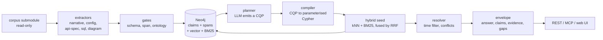

<div align="center">
  
</div>

# Ety&T

An evidence-backed context service that builds relationships of significant terms
with validity, source and confidence. Uses small local models for embedding and semantic lookup.

[](LICENSE)
[](apps/context-service/pyproject.toml)
[](apps/context-service/tests)
[](apps/context-service/pyproject.toml)
[](infra/neo4j/compose.yaml)
[](#quickstart)

Running today: extraction, graph load, hybrid retrieval, REST, MCP over stdio and a web
console, using `vendor/att-hackathon-task` as corpus.

## Why this exists

Regular vector search answers "which text block looks like the question", and here the winner is
often the stale chunk. Relevance is not truth, and a chunk carries no date, no status and no
way to check itself. So the unit of knowledge is a claim: subject, predicate, object,
validity interval, status, confidence, and citations down to `path:line` or image
region.

## Use cases

- "Does inventory-service still use a Redis cache?" returns `VALID ... sqlite` next to
  `DEPRECATED ... redis`, citing the ADR and the release that removed it, not the wiki
  sentence that merely matches the wording.
- Before a change: which claims name the module as a dependency, and which of those are
  still valid at `as_of`.
- Contradiction triage: two sources disagree, both claims are kept, and the pair is
  returned as a conflict with evidence on each side.
- Questions the corpus cannot answer: the envelope says so, sets `degraded: true` and
  lists the gaps instead of writing a confident paragraph.

## What it contains



Pipelines, one per source type:

| Source | Extracts | Shipped |
|---|---|---|
| `docs/adr/`, `releases/`, `incidents/`, `issues/` | narrative claims carrying a status and dates | yes |
| `wiki/`, `docs/`, `meeting-notes/` | prose claims from the header pass | yes |
| `compose.yaml`, `package.json`, `Dockerfile`, `CODEOWNERS` | services, ports, env, dependencies, ownership | yes |
| `api-specs/`, `*.graphql` | one `EXPOSES` claim per method and path, or per field | yes |
| `migrations/*.sql` | `ADD COLUMN` and `RENAME COLUMN` as claims with validity | yes |
| `diagrams/*.png` | `HAS_DECLARED_TYPE` claims via OCR, cited by region | boxes, labels, no edges |
| `*.ts`, `*.py`, `*.java` | code symbols, handlers, endpoint links | no ([ADR-0006](docs/adr/0006-scope-of-the-build.md)) |

Surface:

| Endpoint or tool | Provides |
|---|---|
| `POST /v1/query` | the answer envelope for one question; `as_of`, `status_in`, `token_budget`, `effort`, `detail` |
| `POST /v1/plan` | the Context Query Plan alone, no execution |
| `GET /v1/span` | the cited lines as `text/plain`; add `region=x,y,w,h` for a PNG crop |
| `GET /v1/mcp` | the four tool specs with real parameter schemas |
| `POST /v1/mcp/<tool>` | `{tool, params, result}` from the same functions the stdio server registers |
| `context_search` | what is true about a component now, or as of a date, with status and citations |
| `context_explain_relationship` | how two things connect: linked claims one hop away, with evidence |
| `context_risks` | what is stale, disputed or contradictory around a subject |
| `resolve_span` | the exact lines a citation points at, or an image region as a PNG |

`effort` runs 0-4 and sets how much of the graph is traversed and how much evidence is
returned; `detail` is `low`, `medium` or `high` and sets the envelope size. Defaults:
REST answers at `medium`, MCP tools at `low`.

## Quickstart

```sh
git clone --recurse-submodules <repo-url> winning-context-app
cd winning-context-app
make ui-build      # etynt_gui/dist is not tracked, and the image needs it
make docker-up     # neo4j + ollama + app, returning only once all three are healthy
make docker-demo   # pull both models, then extract, load and index in the app container
```

The console and the API are then on `http://127.0.0.1:8000`.


## Point your agent at it

```json
{
  "mcpServers": {
    "etyt-context": {
      "command": "uv",
      "args": ["--directory", "/path/to/winning-context-app/apps/context-service",
               "run", "python", "-m", "cli", "mcp"],
      "env": {
        "NEO4J_URI": "bolt://localhost:7687",
        "NEO4J_USER": "neo4j",
        "NEO4J_PASSWORD": "etyt-context"
      }
    }
  }
}
```

Start with `context_search` to get ranked claims, then call `resolve_span` on a citation
before acting on it.

## Develop

| Target | Does |
|---|---|
| `make up` | start Neo4j, Ollama and the app, waiting for healthchecks |
| `make down` | stop the containers |
| `make docker-up` | build and start the container stack, returning when healthy |
| `make docker-down` | stop the container stack |
| `make models` | pull `nomic-embed-text` and `llama3.2` into the ollama container |
| `make docker-index` | chunk and embed the corpus inside the app container |
| `make docker-demo` | `docker-up` plus `models`, then extract, load, index in the container |
| `make extract` | deterministic claims to `data/local/claims-extracted.jsonl` |
| `make index` | chunk the corpus, build vector, BM25 and vocabulary layers |
| `make load` | fixtures and extracted claims into the graph |
| `make serve` | REST on `:8000`, API only |
| `make ui-build` | `npm ci` then `vite build` into `etynt_gui/dist` |
| `make ui` | rebuild `etynt_gui/dist` when stale, then serve page and API on `:8000` |
| `make mcp` | MCP over stdio |
| `make demo` | up, extract, load, index, then print the query to run |
| `make test` | `uv run pytest -q` |
| `make lint` | `uv run ruff check .` |
| `make fmt` | `uv run ruff format .` |
| `make e2e` | prove the containerised stack answers REST and MCP |
| `make rehearse` | the demo rehearsal script |
| `make check` | lint plus test, the commit gate |
| `make gpu` | is the model actually on the card |
| `make install-hooks` | point git at `.githooks` |
| `make issues` | file the work queue as GitHub issues |

`cd apps/context-service && uv run pytest -q` passes 228 tests with no model and no
network; the two container-contract tests skip unless the Docker stack is up.

| Path | Holds |
|---|---|
| `apps/context-service` | Python 3.12 service: `ingest/`, `graph/`, `retrieval/`, `api/`, `mcp_server/`, `models/` |
| `etynt_gui` | React 19 and Vite web console, built to `etynt_gui/dist` |
| `apps/context-service/tests/golden` | the seven corpus traps, asserted against a live graph |
| `docs` | the design record `00` to `11`, and `adr/` |
| `data/fixtures` | reviewed claims, loaded alongside extraction |
| `data/local` | extraction output, gitignored |
| `indexes` | gitignored derived stores; the shipped index lives in Neo4j |
| `vendor/att-hackathon-task` | the corpus submodule, read-only, MIT |

## Documentation

- [docs/README.md](docs/README.md) - the index of the design record
- [02 - architecture](docs/02-architecture.md) - the system end to end
- [03 - ontology](docs/03-ontology.md) - what a claim is, and the three planes
- [04 - temporal model](docs/04-temporal-model.md) - how valid and deprecated are decided
- [07 - API and MCP](docs/07-api-and-mcp.md) - the transport surface
- [docs/adr/](docs/adr/) - decisions with their alternatives and trade-offs

## License

Mozilla Public License 2.0; see [LICENSE](LICENSE). The vendored corpus in
`vendor/att-hackathon-task` is read-only and stays under its authors' MIT license.

## Disclaimer

This project was done as a part of AT&T hackathon 2026.
This project was made by AI agents with assistance of a human.
