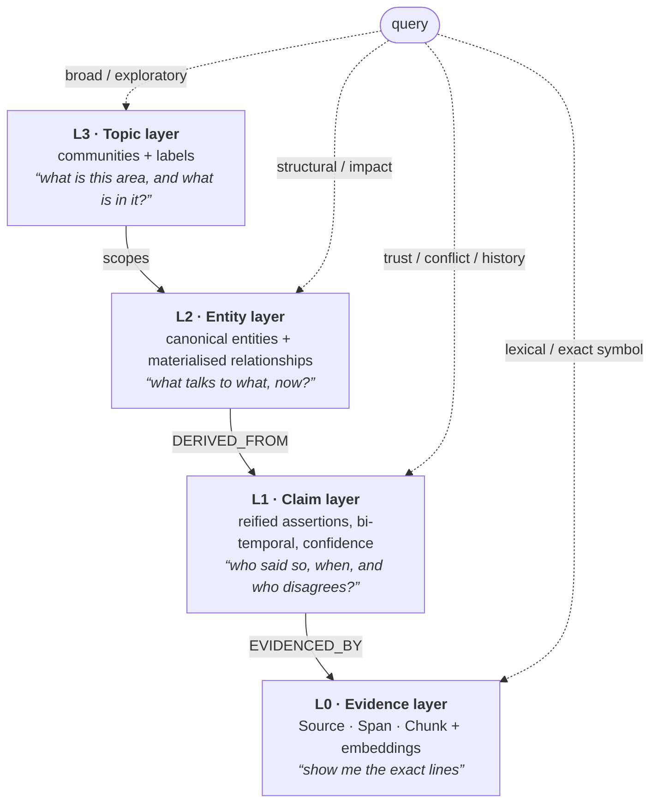
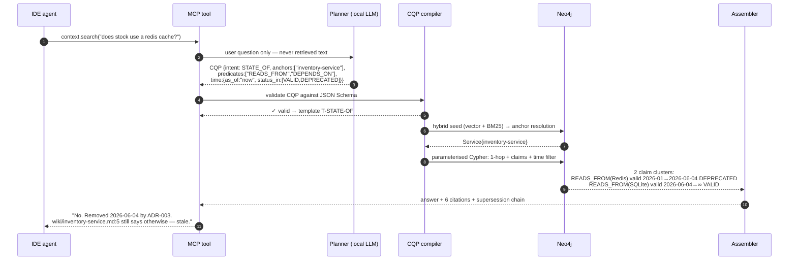

# 02 — Architecture

## Thesis

> A Context Service is not retrieval over a repository. It is **an evidence graph with
> time on every edge.**

The corpus survey showed why ([01](01-corpus-survey.md#what-the-corpus-tells-us-to-build)):
in every seeded trap, the most *relevant* passage is the *stale* one. Relevance
ranking cannot fix this, because the stale passage is genuinely the most relevant —
it is simply no longer true. The only repair is to carry, on every single assertion,
the answer to "who said this, when, about what period, and does anything disagree?"

So the unit of knowledge in this system is not a chunk and not a triple. It is a
**Claim**: a reified statement with provenance, a validity interval, a status and a
confidence. Entities and their relationships are *derived* from claims, never
asserted directly by an extractor.

Three consequences shape everything downstream:

1. **Extraction is cheap and wide; resolution is where the intelligence is.** Any
   pipeline may emit a claim. Claims are allowed to contradict each other. A separate,
   deterministic-first resolver decides what is currently true.
2. **Nothing is merged on resemblance.** The corpus explicitly plants shared emails
   and duplicate class names that must *not* join (T4, T5). Identity comes from
   declared identifiers; resemblance is recorded as a disputed observation.
3. **The query path never improvises.** A planner LLM emits a validated query plan,
   never a query. A deterministic compiler turns the plan into parameterised Cypher.

## System overview

```mermaid
flowchart TB
    subgraph SRC["Sources — vendor/att-hackathon-task (read-only)"]
        direction LR
        S1["code<br/>ts · py · java"]
        S2["config<br/>compose · manifests"]
        S3["api specs<br/>openapi · graphql"]
        S4["schemas<br/>sql migrations"]
        S5["narrative<br/>adr · wiki · notes<br/>issues · incidents · releases"]
        S6["diagrams<br/>png"]
    end

    SRC --> WALK["Walker + content router<br/><i>content-hash addressed, incremental</i>"]

    subgraph ETL["ETL — six pipelines documented, four ship"]
        direction LR
        P2[ConfigPipeline]
        P3[ApiSpecPipeline]
        P4[SchemaPipeline]
        P5["NarrativePipeline<br/>header pass"]
        P1["CodePipeline · forward"]:::fwd
        P6["DiagramPipeline · forward"]:::fwd
    end

    WALK --> ETL
    ETL --> CR[["ClaimRecord stream<br/>subject · predicate · object<br/>+ span + time + confidence"]]

    CR --> VAL["Validate<br/><i>ontology + span grounding</i>"]
    VAL --> RES

    subgraph RES["Resolution"]
        direction TB
        R1["Entity resolution<br/><i>declared identifiers only</i>"]
        R2["Temporal resolver<br/><i>valid · deprecated · planned</i>"]
        R3["Conflict detector<br/><i>disputed, both sides kept</i>"]
        R4["Community layer · forward<br/><i>not built</i>"]
        R1 --> R2 --> R3 --> R4
    end

    RES --> KG[("Neo4j<br/>graph + HNSW vector + Lucene BM25")]

    KG --> RET

    subgraph RET["Retrieval"]
        direction TB
        Q1["NL question"] --> Q2["Planner → <b>Context Query Plan</b><br/><i>JSON Schema validated</i>"]
        Q2 --> Q3["Compiler → parameterised Cypher<br/><i>fixed template library</i>"]
        Q3 --> Q4["Hybrid seed → traverse → time filter"]
        Q4 --> Q5["Assemble answer<br/><i>claims + citations + conflicts</i>"]
    end

    RET --> EDGE

    subgraph EDGE["Edge"]
        direction LR
        E1["REST / FastAPI"]
        E2["MCP server<br/>3 workflow tools"]
    end

    EDGE --> USERS["engineers · IDE agents · chat"]

    classDef fwd stroke-dasharray:4 3
```

## The four layers of the index

The user's requirement was a *multilayered graph index that is fast and easy to
navigate*. The layers are not decoration — each exists because a query shape needs it,
and each is cheap because the layer below it already did the expensive work.

| Layer | Holds | Built by | Query it answers |
|---|---|---|---|
| **L0 Evidence** | `Source`, `Span`, `Chunk`; vector + full-text indexes | Walker + chunker + embedder | "where exactly does it say that?" |
| **L1 Claim** | `Claim` nodes with `valid_from/valid_to/observed_at/recorded_at`, `status`, `confidence`, `CONTRADICTS` edges | Six pipelines → validator | "is this still true, and who disagrees?" |
| **L2 Entity** | `Service`, `Datastore`, `Endpoint`, `Table`, `Risk`, `Team`… and **materialised** `CALLS`, `READS_FROM`, `OWNS`, `DEPENDS_ON` carrying the same temporal fields | Resolver promotion | "what breaks if I change this?" |
| **L3 Topic** | `Topic` communities over L2, with member lists and a label | Noun-phrase co-occurrence + Leiden, **no LLM** — *not built* ([ADR-0006](adr/0006-scope-of-the-build.md)) | "what is the stock area, and what's in it?" |

**Why L1 exists at all.** Without reified claims you cannot represent
`docs/adr/004-people-sso.md` (T6) — a *proposal* that explicitly forbids being read as
a decision. In a plain triple store the only choices are to assert
`(People)-[:USES_SSO]->(Accounts)`, which is false, or to drop it, which loses the
knowledge that someone is actively proposing it. L1 says: *this claim exists, status
`PROPOSED`, nobody has accepted it, here is the line.* That is what an engineer
actually needs to know.

**Why L2 exists given L1.** Traversing reified claims is three hops per logical hop,
and impact analysis is the query shape most users want. The resolver *materialises*
only claims that survive validation into direct relationships, each keeping a
`DERIVED_FROM` pointer back to its claims. Fast path and audit path, same graph.

**Why L3 exists and why it has no LLM in it — and why it is not in the build.** Microsoft's LazyGraphRAG result is the
relevant evidence: deferring all LLM use to query time gives indexing cost identical
to plain vector RAG — 0.1% of full GraphRAG — while matching or beating GraphRAG
global search at ~4% of its query cost
([source](research/sources.md#lazygraphrag)). The design builds the community structure
with noun-phrase co-occurrence and graph statistics, and spends LLM tokens only on the
communities a query actually touches. **It is not in the five-hour build**
([ADR-0006](adr/0006-scope-of-the-build.md)): with local models a pre-summarising index
layer is unaffordable, and the research says we would be paying for summaries nobody
reads. It is the first thing built after the demo.

## Data flow for one question

Worked against trap T1 — *"Does the stock service use a Redis cache?"*

The important step is **6**. The time filter is not a re-ranking heuristic; it is a
`WHERE` clause over interval columns. The stale wiki claim is not suppressed — it is
returned, labelled `DEPRECATED`, with the record that superseded it. An engineer who
asks "why does the wiki say Redis?" gets an answer; an agent that would otherwise
generate `REDIS_URL` config does not.

## Technology choices

Settled with the team on 2026-11-06. Full reasoning in [adr/](adr/).

| Concern | Choice | Why, in one line |
|---|---|---|
| Language | **Python 3.12** | tree-sitter, pydantic, ollama and the MCP SDK are all first-class; one language for four developers |
| Store | **Neo4j 5.x** | graph + HNSW vector index + Lucene full-text in **one** engine — hybrid retrieval without a second system to sync ([ADR-0001](adr/0001-single-store-neo4j.md)) |
| Models | **Ollama, local** | no key, no cost, no rate limit, offline-capable; forces the deterministic-first design the corpus rewards ([ADR-0005](adr/0005-local-models-deterministic-first.md)) |
| Embeddings | `nomic-embed-text` (768-d) | runs on a laptop; upgrade path to `qwen3-embedding` documented, dimension is config |
| Structure | pydantic v2 + JSON Schema | one envelope definition generates validator, Ollama `format` constraint, and the API schema |
| Code parsing | tree-sitter | one parser family for TS/JS/Python/Java; no language servers to install |
| API | FastAPI | REST and MCP over the same service layer |
| MCP | `mcp` Python SDK, stdio | what Claude Code / Cursor / Zed consume natively |

### Things deliberately not used

- **A separate vector database.** Neo4j's native vector index removes an entire
  sync problem. At 374 files the performance argument for a dedicated engine does not
  exist, and a second store is a second thing that can be stale — which would be
  ironic.
- **Text2Cypher.** The 2026 literature is consistent that free-form generated Cypher
  fails on syntax and schema mismatch and needs grammar- and schema-aware filtering to
  be usable ([sources](research/sources.md#text2cypher)). We take the stronger
  position: the model never emits Cypher. See [06](06-retrieval.md).
- **Full GraphRAG community summarisation.** Priced out above.
- **Kùzu**, despite being the natural embedded-graph choice: the upstream repository
  was archived on 2025-10-10 after an acquisition and is read-only
  ([sources](research/sources.md#kuzu)). Not a dependency to adopt this week.

## Where this scales, and where it doesn't

Honest version, because [Forward View](09-evaluation.md#forward-view) is 10 points and
hand-waving is detectable.

**Scales cleanly.** Ingestion is content-hash addressed and per-file independent, so
it parallelises by file and re-indexes only changed blobs. The claim envelope is the
only contract between pipelines, so a ninth source type is a new pipeline and zero
changes elsewhere. Neo4j handles tens of millions of nodes; the L3 layer keeps
traversal scoped so query cost grows with the *answer*, not the corpus.

**Breaks first.** (1) The temporal resolver is global — it compares every claim against
every other claim about the same subject-predicate, which is quadratic per subject;
it needs partitioning by subject beyond ~10⁵ claims. (2) Community detection is a
full-graph batch job; incremental Leiden is a known hard problem and we would move to
periodic rebuilds. (3) Local-model extraction throughput is ~1–3 files/second on a
laptop — fine for 374 files, 11 hours for 100k. That is a batch-infrastructure
problem with a known shape, not an architectural one.
