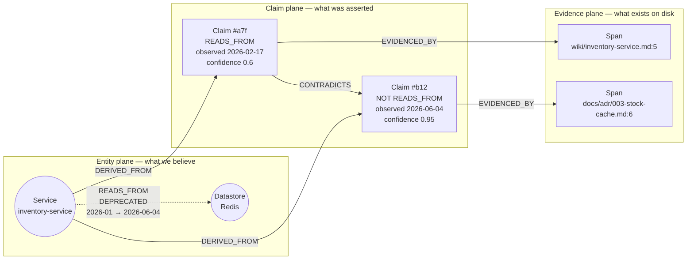

# 03 — Ontology and knowledge representation

This is the 25-point document. The rubric asks for an ontology that represents a
source *"from multiple perspectives, such as concepts, policies, systems,
relationships, dependencies, risks, and evidence"* and explains how knowledge is
*"structured, validated, stored, indexed and retrieved… while keeping the context
trustworthy."* Those seven words are the node taxonomy below, deliberately.

## Three planes

The central modelling decision is to separate **what a source says** from **what is
true**, with an explicit, auditable promotion step between them.



Reading the picture: the wiki *asserted* a Redis read in February; the ADR *asserted*
its removal in June; the two claims contradict; the resolver materialised one
relationship carrying a closed validity interval and a `DEPRECATED` status, with
pointers back to both claims and both exact spans.

This structure is borrowed from W3C PROV-O's `Entity` / `Activity` / `Agent`
separation ([sources](research/sources.md#prov-o)), simplified to what a five-hour
build can carry. We do not emit RDF; we use the *shape*, because the shape is what
makes an answer auditable.

## Node taxonomy

Every node carries `id` (stable, content-derived), `created_at`, `updated_at`.

### Evidence plane (L0)

| Label | Key properties | Notes |
|---|---|---|
| `Source` | `path`, `content_hash`, `source_type`, `git_last_modified`, `authority` | One per file. `path` is relative to the submodule root — never absolute. |
| `Span` | `start_line`, `end_line`, `byte_start`, `byte_end`, `excerpt` | The citation unit. Every claim points at ≥1. |
| `Chunk` | `text`, `embedding`, `token_count`, `heading_path` | Retrieval unit. Vector + full-text indexed. |

### Claim plane (L1)

| Label | Key properties |
|---|---|
| `Claim` | `predicate`, `polarity` (`ASSERTS`/`NEGATES`), `valid_from`, `valid_to`, `observed_at`, `recorded_at`, `status`, `confidence`, `extractor`, `extractor_version`, `modality` |

`modality` is the grammatical force of the statement and is what makes T6 (proposal
vs decision) representable: `FACT` · `DECISION` · `PROPOSAL` · `PLAN` · `HYPOTHESIS`
· `PROHIBITION`. `docs/adr/004-people-sso.md` yields a `PROPOSAL`; its closing
sentence *"must not be interpreted as an approved SSO rollout"* yields a
`PROHIBITION` claim that the resolver treats as a hard block on promotion.

### Entity plane (L2) — the rubric's seven perspectives

| Rubric word | Labels | Examples from the corpus |
|---|---|---|
| **systems** | `Service` `Application` `Package` `Repository` `Environment` | `inventory-service`, `storefront`, `@northstar/logger` |
| **concepts** | `Concept` `Term` | "checkout quote", "SKU", "subjectId" |
| **policies** | `Decision` `Policy` `Convention` | ADR-003, `wiki/logging-standard.md`, CODEOWNERS |
| **relationships** | *(edges — see below)* | |
| **dependencies** | `Datastore` `Library` `Endpoint` `Port` `EnvVar` | SQLite, Redis, `GET /v1/users/:id`, `5005`, `REDIS_URL` |
| **risks** | `Risk` `Vulnerability` `Incident` `Issue` | SEC-22 (CWE-639), `2026-06-02-stock-read` |
| **evidence** | *(the L0 plane)* | |
| *(people/time, needed to resolve the above)* | `Team` `Person` `Release` `Meeting` `Diagram` `Schema` `Table` `Column` | Core Platform, v1.3, `customer-orders-erd.png`, `users.account_status` |

### Topic plane (L3)

| Label | Key properties |
|---|---|
| `Topic` | `label`, `level`, `member_count`, `top_terms`, `centrality` |

## Relationship taxonomy

Materialised L2 relationships carry **the same temporal properties as claims**
(`valid_from`, `valid_to`, `status`, `confidence`) plus `DERIVED_FROM` back-links.
A relationship without a time window is not representable in this schema — that is
enforced by the Neo4j constraint set below.

| Family | Relationships |
|---|---|
| Runtime | `CALLS` `READS_FROM` `WRITES_TO` `EXPOSES` `LISTENS_ON` `AUTHENTICATES_VIA` |
| Build | `DEPENDS_ON` `IMPORTS` `BUILDS_FROM` `DEPLOYED_BY` `MEMBER_OF_WORKSPACE` |
| Data | `DEFINES_TABLE` `HAS_COLUMN` `MIGRATES` `SHARES_SCHEMA_WITH` |
| Governance | `OWNS` `DECIDED_BY` `SUPERSEDES` `IMPLEMENTS` `VIOLATES` `PROHIBITS` |
| Narrative | `MENTIONS` `CAUSED_BY` `RESOLVED_BY` `PLANNED_IN` `DISCUSSED_IN` |
| Trust | `CONTRADICTS` `CORROBORATES` `SIMILAR_NAME_TO` `DERIVED_FROM` `EVIDENCED_BY` |

`SUPERSEDES`, `CONTRADICTS` and `SIMILAR_NAME_TO` are the three that carry the
trustworthiness requirement. `SIMILAR_NAME_TO` in particular is the designed-in
answer to trap T4/T5: a resemblance we noticed and deliberately refused to act on.

## Entity resolution policy

The corpus actively punishes eager merging ([01 — T4, T5](01-corpus-survey.md#t4--shared-attribute-that-is-not-a-join-key)).
The 2026 consensus in the entity-resolution literature is a cascade — deterministic
rules for the extremes, a scorer for the bulk, LLM adjudication only for the
contested middle, because teams that replaced rules with LLMs walked it back on cost
and consistency ([sources](research/sources.md#entity-resolution)). Our cascade is
deliberately truncated at the rules stage for identity:

**Tier 1 — merge (deterministic only).** Identical normalised path; identical package
name in a manifest; identical service key in `config/ports.json` or `compose.yaml`;
identical declared identifier (`cus-`/`emp-` prefix match through the explicit
properties mapping in `docs/design/people-account-link.md`).

**Tier 2 — link, do not merge.** Same symbol name in different workspace scopes →
`SIMILAR_NAME_TO {status: DISPUTED}`. Same email across `emp-`/`cus-` domains →
`SIMILAR_NAME_TO {status: DISPUTED, note: "shared email is not a documented FK"}`.

**Tier 3 — never.** Embedding similarity, display-name similarity, or an LLM
judgement, as the *sole* basis for identity. An LLM may *propose* a merge; it lands
as a `Claim` with `modality: HYPOTHESIS` for a human to accept.

Scope is the tie-breaker, and it is machine-readable: `pnpm-workspace.yaml`,
`turbo.json` and `compose.yaml` profiles define the active workspace. `archive/` is
outside it. That alone resolves both name collisions without a single model call.

## Source authority

Not all sources are equal witnesses, and the ranking is a property of *what kind of
artefact it is*, not of how confident it sounds. This is the prior that the temporal
resolver combines with recency ([04](04-temporal-model.md#resolution-algorithm)).

| Tier | `authority` | Sources | Rationale |
|---:|---:|---|---|
| 1 | 1.00 | SQL migrations, `package.json`/`requirements.txt`, `compose.yaml`, Dockerfiles, `config/ports.json` | Machine-executed. If it were wrong the system would not run. |
| 2 | 0.90 | Application source code (tree-sitter facts) | Ground truth for behaviour; may be dead code. |
| 3 | 0.85 | OpenAPI/GraphQL under `api-specs/` (not `history/`) | Contract of record. |
| 4 | 0.80 | ADRs with `Status: Accepted`; release notes | Dated, authoritative, explicitly governance. |
| 5 | 0.65 | `docs/` design notes, runbooks, how-tos | Intentional but may lag. |
| 6 | 0.55 | Incidents, issues | Dated and specific, but often hypotheses. |
| 7 | 0.50 | Meeting notes | Dated; records intent, not outcome. |
| 8 | 0.45 | `wiki/` | Team handbooks; the corpus's main stale-doc vector. |
| 9 | 0.40 | Diagrams (VLM-extracted) | Capped — see [05](05-extraction-pipelines.md#diagrampipeline--diagramspng). |
| 10 | 0.20 | `api-specs/history/`, `archive/` | Explicitly superseded or abandoned by path. |

The ranking is a config file, not code. It is the single most contestable thing in
this design and a judge should be able to argue with it by editing one table.

## Storage, indexing and validation in Neo4j

Three index types in one engine — this is the whole reason for the single-store
choice ([ADR-0001](adr/0001-single-store-neo4j.md)).

```cypher
// --- L0: evidence + hybrid retrieval ---------------------------------------
CREATE CONSTRAINT source_path IF NOT EXISTS
  FOR (s:Source) REQUIRE s.path IS UNIQUE;

CREATE VECTOR INDEX chunk_embedding IF NOT EXISTS
  FOR (c:Chunk) ON c.embedding
  OPTIONS {indexConfig: {
    `vector.dimensions`: 768,
    `vector.similarity_function`: 'cosine'
  }};

CREATE FULLTEXT INDEX chunk_text IF NOT EXISTS
  FOR (c:Chunk) ON EACH [c.text];          // Lucene BM25 — exact symbols, SKUs, env vars

// --- L1: claims must be grounded and time-stamped ---------------------------
CREATE CONSTRAINT claim_id IF NOT EXISTS
  FOR (cl:Claim) REQUIRE cl.id IS UNIQUE;
CREATE CONSTRAINT claim_grounded IF NOT EXISTS
  FOR (cl:Claim) REQUIRE cl.observed_at IS NOT NULL;
CREATE CONSTRAINT claim_status IF NOT EXISTS
  FOR (cl:Claim) REQUIRE cl.status IS NOT NULL;

// --- L2: entities ------------------------------------------------------------
CREATE CONSTRAINT service_key IF NOT EXISTS
  FOR (s:Service) REQUIRE s.key IS UNIQUE;
CREATE INDEX rel_validity IF NOT EXISTS
  FOR ()-[r:CALLS]-() ON (r.valid_from, r.valid_to);
```

**Validation is three gates, all of which must pass before a claim is written:**

1. **Schema gate** — the `ClaimRecord` is parsed by its pydantic model. The same
   model is handed to Ollama as a JSON Schema `format` constraint, so a local model
   is structurally constrained at generation time rather than corrected afterwards
   ([sources](research/sources.md#ontology-guided-extraction)).
2. **Span gate** — `span.excerpt` must occur verbatim at `span.start_line..end_line`
   in the file at `source.content_hash`. **A claim whose quoted evidence is not
   literally in the file is dropped, not repaired.** This is the single most
   effective anti-hallucination measure available to us and it costs nothing.
3. **Ontology gate** — `predicate` must exist in the taxonomy above, and the
   subject/object labels must satisfy the predicate's declared domain and range
   (`READS_FROM : Service → Datastore`, not `Service → Person`). Violations are
   logged with the offending record and the batch continues.

Gate 2 is why this is "evidence-backed" rather than "evidence-flavoured". Every
claim in the graph is reproducibly checkable against a byte range of a file at a
known hash.
