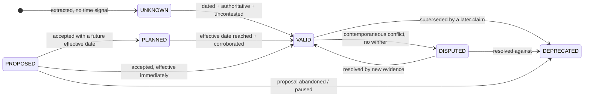

# 04 — Temporal model

The requirement: *data must be labelled chronologically with validity timestamps, so
that queries can be filtered for at least deprecated, valid, and planned-for-future
data.* The corpus makes this not a feature but the load-bearing wall —
four of seven seeded traps are pure time
([01](01-corpus-survey.md#the-trap-catalogue)).

## Bi-temporal, because one clock is not enough

Every claim and every materialised relationship carries four timestamps. The
distinction between the pairs is the standard bi-temporal one, as implemented in
Graphiti/Zep for agent memory and in the PostgreSQL-native `post-graph-rag` work
([sources](research/sources.md#bitemporal)):

| Field | Meaning | Example (T1) |
|---|---|---|
| `valid_from` | when the fact became true **in the world** | `2026-01-01` |
| `valid_to` | when it stopped being true; `null` = still open | `2026-06-04` |
| `observed_at` | when **a source stated it** | `2026-02-17` (the wiki byline) |
| `recorded_at` | when **our pipeline ingested it** | `2026-11-06T14:22Z` |

Why both axes earn their keep here:

- **valid vs observed** answers *"the wiki said in February that there is a cache —
  was it wrong?"* No: it was right when written, and the world changed in June. The
  wiki is stale, not incorrect. A service that cannot say this will keep telling
  engineers their documentation lies to them, which is both unhelpful and untrue.
- **recorded_at** makes the index auditable and re-runnable. "What did the Context
  Service believe last Tuesday?" is answerable, which matters the first time a
  generated answer is wrong and someone has to reconstruct why.

Crucially, **contradiction never deletes**. When a later claim supersedes an earlier
one, the earlier one's `valid_to` is closed and its status becomes `DEPRECATED`. It
stays queryable forever. This is what lets the service answer *"why does the wiki say
Redis?"* instead of just *"there is no Redis."*

## Status lattice

Derived, never guessed. Six values; the user asked for at least three and the corpus
forces the other three.



| Status | Means | Corpus example |
|---|---|---|
| `VALID` | true now, best evidence | SQLite on the stock read path (ADR-003 + release 1.3 + Sept diagram) |
| `DEPRECATED` | was true, superseded | Redis read cache; `api-specs/history/accounts-v1`; `users.status` column |
| `PLANNED` | accepted, not yet effective | warehouse console migration, *"scheduled after gateway adoption"* |
| `PROPOSED` | suggested, not accepted | ADR-004 People SSO, `Status: Proposed` |
| `DISPUTED` | sources conflict, no winner | SEC-22's suspected authorisation gap |
| `UNKNOWN` | no usable time signal | an undated code fact with no release reference |

`PROPOSED` and `PLANNED` are distinct on purpose. ADR-004 is *not* planned work —
nobody approved it, the issuer and lifecycle are open questions, and the document
itself forbids reading it as approved. Collapsing the two would tell an engineer that
SSO is coming. The warehouse-console migration *is* planned: the decision exists, only
the date is conditional. The difference between "someone wants this" and "this is
coming" is exactly the difference between a wasted sprint and a correct one.

## Where time comes from

There is no front matter in this corpus ([01](01-corpus-survey.md#metadata-reality-check)),
so extraction is layered, highest-trust first, and each layer records *how* it got
the date so the confidence can be audited:

| Order | Signal | Method | Confidence |
|---:|---|---|---:|
| 1 | Explicit field | `^Date: (\d{4}-\d{2}-\d{2})$`, `^Status: (\w+)$` — ADRs | 1.00 |
| 2 | Filename | `incidents/2026-06-02-*.md`, `releases/2026-06-v1.3.md`, `meeting-notes/` | 0.95 |
| 3 | Byline | `· 2026-02-17`, `Last edited 2026-02-03`, `Open · 2026-09-11` | 0.90 |
| 4 | Path convention | `api-specs/history/**` → `DEPRECATED`; `archive/**` → `DEPRECATED` | 0.95 |
| 5 | Migration order | `001-users.sql` < `002-account-tiers.sql`; each bounded by its release | 0.85 |
| 6 | Diagram title | `"September 2026"` rendered in the image | 0.70 (VLM-capped) |
| 7 | Git history | `git log -1 --format=%aI -- <path>` | 0.60 — *file mtime ≠ fact validity* |
| 8 | Prose temporal cue | "scheduled after", "remains a proposal", "effective date next month", "paused" | 0.55 — sets **modality**, not a date |

Signals 1–5 are regex and filesystem work: **the majority of the temporal signal in
this corpus is extractable with no model at all.** That is a deliberate design
position, not a limitation of our model access — a regex that reads
`Status: Accepted` is more reliable than any local 7B model and is free.

Signal 8 is the one place a model earns its cost: classifying the *modality* of a
sentence ("is this asserting, proposing, planning, or prohibiting?") is genuinely
linguistic. It is a constrained six-way classification with the JSON Schema enforced
at generation, which is well within a local model's competence.

## Partial dates: one rule, both edges safe

Most temporal signal in this corpus is month- or path-precision, not day-precision
(`releases/2026-06-v1.3.md`, `diagrams/architecture-january.png`). Collapse it once, at
extraction, and record that you did:

| Edge | Month `2026-06` becomes | Why |
|---|---|---|
| `valid_from` | `2026-06-01` (first day) | the fact cannot be true *before* the period, so the earliest defensible day |
| `valid_to` | `2026-06-30` (last day) | a supersession in June must not appear to take effect on June 1 |

Both fields carry `valid_from_precision` / `valid_to_precision` (`day` | `month`), so the
expansion is reversible and auditable, and a query can widen to "any day in June" when it
needs to be conservative. Without this rule the March time-travel query in
[08](08-delivery-plan.md#demo-script) passes or fails depending on which day you pick, and
every supersession in the corpus is silently biased by up to a month.

## Resolution algorithm

Runs after extraction, before materialisation. Deterministic; no model in the loop.

For each `(subject, predicate, object)` group, ordered by `observed_at`:

1. **Score each claim.** `score = authority × time_confidence × extractor_confidence`,
   where `authority` is the source-tier prior from
   [03](03-ontology.md#source-authority).
2. **Apply explicit supersession.** If a claim's text names an earlier artefact
   (`"ADR-003 and INV-190 record the follow-up"`, `"follows ADR-003"`), write
   `SUPERSEDES` and close the earlier claim's `valid_to` at the later claim's
   `valid_from`. Explicit beats inferred, always.
3. **Apply negation.** A later `NEGATES` claim ("Remove Redis from the local inventory
   path") closes every open `ASSERTS` claim for the same triple. This is how T1 resolves.
4. **Apply prohibition.** An active `PROHIBITION` claim blocks promotion of any claim
   it names, regardless of score. ADR-004's closing sentence is such a block: it
   prevents the SSO proposal from ever being materialised as a relationship.
5. **Rank the survivors.** Highest score wins → `VALID`. Losers with an earlier
   `valid_from` → `DEPRECATED`. Losers with `modality ∈ {PROPOSAL, PLAN}` →
   `PROPOSED`/`PLANNED` and are never compared against facts for supersession.
6. **Detect genuine ties.** Two claims with overlapping validity, scores within 0.15,
   and no supersession link → both `DISPUTED`, linked by `CONTRADICTS`. **The service
   never picks a winner by coin-flip; it reports the disagreement.**
7. **Corroborate.** Two independent claims (different `source_type`) agreeing on the
   same triple → `CORROBORATES` and `confidence = 1 − ∏(1 − cᵢ)`. This is how the
   September diagram, ADR-003 and release 1.3 jointly make "SQLite on the read path"
   near-certain, and the mechanism that promotes SEC-22 from lead to finding if
   static analysis independently flags the same handler.

Worked trace for T1:

| Claim | Source | authority | observed | modality | Outcome |
|---|---|---:|---|---|---|
| `inventory-service READS_FROM Redis` | `wiki/inventory-service.md:5` | 0.45 | 2026-02-17 | FACT | `DEPRECATED`, `valid_to=2026-06-04` (step 3) |
| `inventory-service READS_FROM Redis` | `diagrams/architecture-january.png` | 0.40 | 2026-01 | FACT | `DEPRECATED`, `valid_to=2026-06-04` |
| `NOT inventory-service READS_FROM Redis` | `docs/adr/003-stock-cache.md:6` | 0.80 | 2026-06-04 | DECISION | `VALID` — the negation |
| `inventory-service READS_FROM SQLite` | `releases/2026-06-v1.3.md` | 0.80 | 2026-06 | FACT | `VALID`, corroborated → 0.96 |
| `inventory-service READS_FROM SQLite` | `apps/inventory-service/app.py` | 0.90 | — | FACT | `VALID`, corroborates the above |

Note what happens without step 3: the two Redis claims and the two SQLite claims are
contemporaneous-ish and all score respectably, and a scoring-only system returns
`DISPUTED` — an honest non-answer. Explicit negation handling is what converts it into
a correct answer. Most of the intelligence here is in reading what the documents
*literally say about each other*.

## Querying time

Every retrieval call takes a time filter, defaulting to "current truth":

```jsonc
"time": {
  "as_of": "now",                       // or an ISO date for point-in-time
  "status_in": ["VALID"],               // the default
  "include_superseded_chain": true      // return what replaced what
}
```

Three canonical modes:

- **Current** (`status_in: [VALID]`) — default for IDE agents. What should I build against.
- **Point-in-time** (`as_of: "2026-03-01"`) — `valid_from ≤ t AND (valid_to IS NULL OR valid_to > t)`.
  Incident reconstruction: *what was the architecture when this outage happened?*
- **Full history** (`status_in: [VALID, DEPRECATED, PLANNED, PROPOSED, DISPUTED]`) —
  the stale-documentation audit. This is how a team finds every wiki page that needs
  rewriting, which is the feature that makes the service pay for itself after the demo.

Compiled to Cypher, the filter is an interval predicate on indexed relationship
properties — not a re-ranking heuristic:

```cypher
MATCH (s:Service {key: $anchor})-[r:READS_FROM]->(d:Datastore)
WHERE ($as_of IS NULL OR (r.valid_from <= $as_of
       AND (r.valid_to IS NULL OR r.valid_to > $as_of)))
  AND r.status IN $status_in
OPTIONAL MATCH (r_claim:Claim)<-[:DERIVED_FROM]-(r)
OPTIONAL MATCH (r_claim)-[:EVIDENCED_BY]->(sp:Span)-[:IN]->(src:Source)
RETURN d, r.status, r.valid_from, r.valid_to,
       collect({path: src.path, lines: [sp.start_line, sp.end_line],
                excerpt: sp.excerpt}) AS citations;
```
