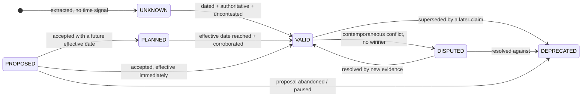

# 04 — Temporal model

The requirement: *data must be labelled chronologically with validity timestamps, so
that queries can be filtered for at least deprecated, valid, and planned-for-future
data.* The corpus makes this not a feature but the load-bearing wall —
four of seven seeded traps are pure time
([01](01-corpus-survey.md#the-trap-catalogue)).

## Bi-temporal, because one clock is not enough

Every claim and every materialised relationship carries four timestamps. The
distinction between the pairs is the standard bi-temporal one, as implemented in
Graphiti/Zep for agent memory and in the PostgreSQL-native `post-graph-rag` work
([sources](research/sources.md#bitemporal)):

| Field | Meaning | Example (T1) |
|---|---|---|
| `valid_from` | when the fact became true **in the world** | `2026-01-01` |
| `valid_to` | when it stopped being true; `null` = still open | `2026-06-04` |
| `observed_at` | when **a source stated it** | `2026-02-17` (the wiki byline) |
| `recorded_at` | when **our pipeline ingested it** | `2026-11-06T14:22Z` |

Why both axes earn their keep here:

- **valid vs observed** answers *"the wiki said in February that there is a cache —
  was it wrong?"* No: it was right when written, and the world changed in June. The
  wiki is stale, not incorrect. A service that cannot say this will keep telling
  engineers their documentation lies to them, which is both unhelpful and untrue.
- **recorded_at** makes the index auditable and re-runnable. "What did the Context
  Service believe last Tuesday?" is answerable, which matters the first time a
  generated answer is wrong and someone has to reconstruct why.

Crucially, **contradiction never deletes**. When a later claim supersedes an earlier
one, the earlier one's `valid_to` is closed and its status becomes `DEPRECATED`. It
stays queryable forever. This is what lets the service answer *"why does the wiki say
Redis?"* instead of just *"there is no Redis."*

## Status lattice

Derived, never guessed. Six values; the user asked for at least three and the corpus
forces the other three.



| Status | Means | Corpus example |
|---|---|---|
| `VALID` | true now, best evidence | SQLite on the stock read path (ADR-003 + release 1.3 + Sept diagram) |
| `DEPRECATED` | was true, superseded | Redis read cache; `api-specs/history/accounts-v1`; `users.status` column |
| `PLANNED` | accepted, not yet effective | warehouse console migration, *"scheduled after gateway adoption"* |
| `PROPOSED` | suggested, not accepted | ADR-004 People SSO, `Status: Proposed` |
| `DISPUTED` | sources conflict, no winner | SEC-22's suspected authorisation gap |
| `UNKNOWN` | no usable time signal | an undated code fact with no release reference |

`PROPOSED` and `PLANNED` are distinct on purpose. ADR-004 is *not* planned work —
nobody approved it, the issuer and lifecycle are open questions, and the document
itself forbids reading it as approved. Collapsing the two would tell an engineer that
SSO is coming. The warehouse-console migration *is* planned: the decision exists, only
the date is conditional. The difference between "someone wants this" and "this is
coming" is exactly the difference between a wasted sprint and a correct one.

## Where time comes from

There is no front matter in this corpus ([01](01-corpus-survey.md#metadata-reality-check)),
so extraction is layered, highest-trust first, and each layer records *how* it got
the date so the confidence can be audited:

| Order | Signal | Method | Confidence |
|---:|---|---|---:|
| 1 | Explicit field | `^Date: (\d{4}-\d{2}-\d{2})$`, `^Status: (\w+)$` — ADRs | 1.00 |
| 2 | Filename | `incidents/2026-06-02-*.md`, `releases/2026-06-v1.3.md`, `meeting-notes/` | 0.95 |
| 3 | Byline | `· 2026-02-17`, `Last edited 2026-02-03`, `Open · 2026-09-11` | 0.90 |
| 4 | Path convention | `api-specs/history/**` → `DEPRECATED`; `archive/**` → `DEPRECATED` | 0.95 |
| 5 | Referenced record | an undated file dated by the record that ships it: `002-account-tiers.sql` ← `releases/2026-03-v1.0.md:5` (the reference is itself span-gated) | 0.85 |
| 6 | Diagram title | `"September 2026"` rendered in the image | 0.70 (VLM-capped) |
| 7 | Git history | `git log -1 --format=%aI -- <path>` | 0.60 — *file mtime ≠ fact validity* |
| 8 | Prose temporal cue | "scheduled after", "remains a proposal", "effective date next month", "paused" | 0.55 — sets **modality**, not a date |

Signals 1–5 are regex and filesystem work: **the majority of the temporal signal in
this corpus is extractable with no model at all.** That is a deliberate design
position, not a limitation of our model access — a regex that reads
`Status: Accepted` is more reliable than any local 7B model and is free.

Signal 8 is the one place a model earns its cost: classifying the *modality* of a
sentence ("is this asserting, proposing, planning, or prohibiting?") is genuinely
linguistic. It is a constrained six-way classification with the JSON Schema enforced
at generation, which is well within a local model's competence.

## Partial dates: one rule, both edges safe

Most temporal signal in this corpus is month- or path-precision, not day-precision
(`releases/2026-06-v1.3.md`, `diagrams/architecture-january.png`). Collapse it once, at
extraction, and record that you did:

| Edge | Month `2026-06` becomes | Why |
|---|---|---|
| `valid_from` | `2026-06-01` (first day) | the fact cannot be true *before* the period, so the earliest defensible day |
| `valid_to` | `2026-06-30` (last day) | a supersession in June must not appear to take effect on June 1 |

Both fields carry `valid_from_precision` / `valid_to_precision` (`day` | `month`), so the
expansion is reversible and auditable, and a query can widen to "any day in June" when it
needs to be conservative. Without this rule the March time-travel query in
[08](08-delivery-plan.md#demo-script) passes or fails depending on which day you pick, and
every supersession in the corpus is silently biased by up to a month.

## Resolution algorithm

Runs after extraction, before materialisation. Deterministic; no model in the loop.
Implemented as pure functions in `apps/context-service/graph/resolve.py`. Nothing in it
names a source type or a document status: every per-type rule is a row in the
[policy tables](#one-rule-set-for-every-kind-of-source).

For each `(subject, predicate, object)` group, at a given `as_of` (claims observed
later do not exist yet):

1. **Score each claim** — see [Scoring](#scoring-and-the-quality-filter) below.
2. **Path rule.** Source types with `deprecated_by_path` (`api-specs/history/**`,
   `archive/**`) → `DEPRECATED`, whatever the text says.
3. **Supersede.** A later `FACT`/`DECISION` of the opposite polarity closes an earlier
   one: `valid_to` = the successor's `valid_from` (month precision → last day of the
   month), status `DEPRECATED`. Guard: the successor must score at least
   `supersede_ratio × ` the earlier claim, so a late wiki page cannot overrule a
   migration. If the closing day is after `as_of` (a June release asked about on
   June 10), the old claim is `DISPUTED` — the day is unknown — not `DEPRECATED`.
   This is how T1 (`ADR-003` negates Redis) and T2 (migration 002 negates `status`)
   resolve. *Explicit textual supersession ("follows ADR-003") is not built yet.*
4. **Rank what is still open.** One polarity left → `VALID`. Both left: scores within
   `tie_margin` → all `DISPUTED`, linked by `CONTRADICTS`; otherwise the stronger side
   is `VALID` and the weaker `DISPUTED`. **The service never picks a winner by
   coin-flip; it reports the disagreement.**
5. **Hypotheses** (`HYPOTHESIS`, e.g. SEC-22) stay `DISPUTED` until a different source
   type agrees. One signal is a lead, not a finding.
6. **Needs corroboration.** If every `VALID` claim on a side comes from source types
   with `needs_corroboration` (diagrams), they are demoted to `DISPUTED`: a drawing
   alone never makes something current. The September diagram's console → gateway
   edge stays `DISPUTED` — exactly what `issues/EDGE-53.md:7` warns: *"A diagram showing
   the target topology should not be used as proof that this ticket is done."*
7. **Proposals and plans.** If a `VALID` fact now says the same thing, the proposal is
   `DEPRECATED` as *realised* (the wiki's "tiers remain a proposal" is stale because
   migration 002 shipped them). If a later fact says the opposite, `DEPRECATED` as
   *overtaken*. An active `PROHIBITION` on the same subject keeps it `PROPOSED` and
   records `blocked_by` (ADR-004). Otherwise `PROPOSED` / `PLANNED`.
8. **Corroborate.** `VALID` claims on the same side combine across **source types**:
   `confidence = 1 − ∏(1 − best score per type)`. Three wiki pages copying each other
   count once.

Worked trace for T1, computed by `uv run ncs resolve --as-of 2026-11-06`:

| Claim | Source | authority × time × extractor × settled × fresh | score | Outcome |
|---|---|---|---:|---|
| `READS_FROM redis` | `wiki/inventory-service.md:5` | 0.45 × 0.90 × 0.80 × 1.00 × 0.52 | 0.168 | `DEPRECATED`, `valid_to=2026-06-04` |
| `READS_FROM redis` | `diagrams/architecture-january.png` | 0.40 × 0.70 × 0.70 × 1.00 × 0.50 | 0.098 | `DEPRECATED`, `valid_to=2026-06-04` |
| `NOT READS_FROM redis` | `docs/adr/003-stock-cache.md:6` | 0.80 × 1.00 × 0.95 × 1.00 × 1.00 | 0.760 | `VALID` |
| `NOT READS_FROM redis` | `releases/2026-06-v1.3.md:5` | 0.80 × 0.95 × 0.95 × 1.00 × 1.00 | 0.722 | `VALID` |
| `NOT READS_FROM redis` | `issues/INV-190.md:5` (`Closed`) | 0.55 × 0.90 × 0.90 × 1.00 × 1.00 | 0.446 | `VALID` → 3 types together 0.96 |
| `READS_FROM sqlite` | ADR-003, release 1.3, INV-190, meeting 06-04, API spec, Sept diagram | — | — | `VALID`, 6 source types → 0.99 |

Note what happens without step 3: the Redis and SQLite claims are contemporaneous-ish
and all score respectably, and a scoring-only system returns `DISPUTED` — an honest
non-answer. Reading what the documents *literally say about each other* is what
converts it into a correct answer.

## One rule set for every kind of source

Diagrams, wikis, API specs, ADRs, issues, migrations and config all pass through the
same three filters. What differs per kind of data is a **row in a table** in
`apps/context-service/settings.py`, never a branch in code. A new source type is one
row in `SOURCES` plus one line in the path router; a new status word is one row in
`DOC_STATUSES`.

**`SOURCES` — per source type** (path → type: `ingest/router.py`):

| Source type | `authority` | `deprecated_by_path` | `needs_corroboration` |
|---|---:|:---:|:---:|
| `MIGRATION`, `CONFIG` | 1.00 | | |
| `CODE` | 0.90 | | |
| `API_SPEC` | 0.85 | | |
| `ADR`, `RELEASE` | 0.80 | | |
| `DESIGN_DOC` | 0.65 | | |
| `ISSUE` (issues, incidents) | 0.55 | | |
| `MEETING` | 0.50 | | |
| `WIKI` | 0.45 | | |
| `DIAGRAM` | 0.40 | | ✓ |
| `HISTORICAL` (`api-specs/history/`, `archive/`) | 0.20 | ✓ | |

**`DOC_STATUSES` — per declared document status.** One reader
(`ingest/headers.py`) for every type, because `Status: Proposed` in an ADR and
`Deferred · 2026-07-17` in an issue are the same fact spelled twice. Unknown words are
ignored, never guessed.

| Status (corpus wording) | `settledness` | A `DECISION` in it becomes | Example |
|---|---:|---|---|
| `accepted`, `closed` | 1.00 | — | `docs/adr/003-stock-cache.md:4`, `issues/INV-190.md:3` |
| `accepted with review` | 0.90 | — | `docs/adr/005-support-access.md:4` |
| `design review` | 0.80 | `PROPOSAL` | `issues/PEOPLE-71.md:3` |
| `open`, `investigating` | 0.75 | `PROPOSAL` | `issues/SEC-22.md:3`, `issues/PAY-118.md:3` |
| `deferred` | 0.70 | `PLAN` | `issues/EDGE-53.md:3` |
| `untriaged`, `proposed` | 0.60 | `PROPOSAL` | `issues/LAB-12.md:3`, `docs/adr/004-people-sso.md:4` |

The cap is the deterministic answer to "can this document decide anything?": a deferred
ticket's "console stock writes through Edge" is a plan, not a decision, whatever the
extractor thought. Facts it *reports* and prohibitions it *states* are not capped — an
open bug's reproduction is still an observation, just a less settled one. Every capped
claim records `modality_capped_from`; `ncs ingest` prints how many.

## Scoring and the quality filter

One number per claim, five factors:

```
score = authority × time_confidence × extractor_confidence × settledness × freshness
```

| Factor | Question it answers | Range | From |
|---|---|---|---|
| `authority` | *What kind of artefact said it?* Machine-executed beats prose. | 0.20–1.00 | `SOURCES` |
| `time_confidence` | *How sure are we of the date?* | 0.60–1.00 | `Date:` field 1.00 · filename 0.95 · byline 0.90 · referenced record 0.85 · diagram title 0.70 · git 0.60 |
| `extractor_confidence` | *How sure was the extractor of the claim?* | 0–1 | the `ClaimRecord` |
| `settledness` | *How final does the document say it is?* | 0.60–1.00 | `DOC_STATUSES`; 1.00 when it declares none |
| `freshness` | *Has something newer contradicted it?* | 0.50–1.00 | halves every 120 days by which the newest contradicting fact is newer; 1.00 when nothing contradicts it |

Freshness is **relative to contradiction, not to today** ([ADR-0007](adr/0007-quality-filter.md)):
an old fact nobody disputes keeps 1.00. The wiki's Redis claim gets 0.52 because INV-190
contradicted it 114 days later (`0.5^(114/120)`); the floor of 0.50 stops age alone from
erasing a strong source.

**`score` vs `confidence`.** `score` is one claim. `confidence` is the statement: for
`VALID` claims it is the corroborated value from step 8; otherwise it equals the score.

**The verdict** is what the answer is split on. One function
(`retrieval/assemble.py:verdict`), three checks in order, the first failure is reported
as `filtered_by`:

| Check | Fails when | `filtered_by` | Default |
|---|---|---|---|
| 1 | status is not `VALID` | `STATUS` | — |
| 2 | `confidence < min_confidence` | `LOW_CONFIDENCE` | 0.40 |
| 3 | fewer independent source types than `min_source_types` | `SINGLE_SOURCE` | 1 |

Pass all three → `claims`, the only thing an agent may state as current. Fail any →
`not_valid`, returned as a warning with its reason, never as fact. Order matters: a stale
claim is reported as stale, not as weak.

Real cases from the fixtures:

- `issues/INV-207.md:5` (open bug, single report) — status `VALID`, confidence 0.30 →
  `LOW_CONFIDENCE`. One unsettled ticket is a lead, not evidence.
- `wiki/inventory-service.md:7` "port 5005" — alone it would score 0.32; with
  `config/ports.json:10` agreeing it is 0.73 → `VALID`. The wiki is not distrusted; it is
  checked.
- With `min_source_types=2`, ADR-005's console exception (one source) → `SINGLE_SOURCE`.

Two request-time knobs reuse the same machinery for any data type, on `context_search`
and `ncs query`: `source_types` shows only statements backed by those types (*"what do
the diagrams say, and is it still true?"*) — they are still judged against every source —
and `min_source_types` raises the corroboration bar.

**Reading a statement** in an answer:

```
- inventory-service READS_FROM redis
    status DEPRECATED · confidence 0.17 · 2026-01-01 → 2026-06-04 · sources diagram, wiki
    why: superseded on 2026-06-04 by docs/adr/003-stock-cache.md:6
```

*"Redis was true from January until 4 June; ADR-003 replaced it; the best surviving
evidence for it is weak."*

**Arguing with it.** Every weight and threshold is in `settings.py` (`SOURCES`,
`DOC_STATUSES`, `TIME_CONFIDENCE`, `freshness_half_life_days`, `freshness_floor`,
`supersede_ratio`, `tie_margin`, `min_confidence`, `min_source_types`), the scalars
overridable as `NCS_<FIELD>`. `uv run ncs resolve` prints every claim with its status,
score and reason, so the effect of a change is visible in one command.

## Querying time

Every retrieval call takes a time filter. By default every status comes back, split by
[verdict](#scoring-and-the-quality-filter): `claims` holds only what is current, and
`not_valid` holds the rest, labelled — because an agent that never sees the stale wiki
claim cannot tell the user why the wiki disagrees.

```jsonc
"time": {
  "as_of": "now",                       // or an ISO date for point-in-time
  "status_in": ["VALID", "DEPRECATED", "PLANNED", "PROPOSED", "DISPUTED", "UNKNOWN"]
}
```

Three canonical modes:

- **Current** (`status_in: [VALID]`) — `valid_only` in the MCP tool. What should I build against.
- **Point-in-time** (`as_of: "2026-03-01"`) — `valid_from ≤ t AND (valid_to IS NULL OR valid_to > t)`.
  Incident reconstruction: *what was the architecture when this outage happened?*
- **Full history** (`status_in: [VALID, DEPRECATED, PLANNED, PROPOSED, DISPUTED]`) —
  the stale-documentation audit. This is how a team finds every wiki page that needs
  rewriting, which is the feature that makes the service pay for itself after the demo.

Compiled to Cypher, the filter is an interval predicate on indexed relationship
properties — not a re-ranking heuristic:

```cypher
MATCH (s:Service {key: $anchor})-[r:READS_FROM]->(d:Datastore)
WHERE ($as_of IS NULL OR (r.valid_from <= $as_of
       AND (r.valid_to IS NULL OR r.valid_to > $as_of)))
  AND r.status IN $status_in
OPTIONAL MATCH (r_claim:Claim)<-[:DERIVED_FROM]-(r)
OPTIONAL MATCH (r_claim)-[:EVIDENCED_BY]->(sp:Span)-[:IN]->(src:Source)
RETURN d, r.status, r.valid_from, r.valid_to,
       collect({path: src.path, lines: [sp.start_line, sp.end_line],
                excerpt: sp.excerpt}) AS citations;
```
