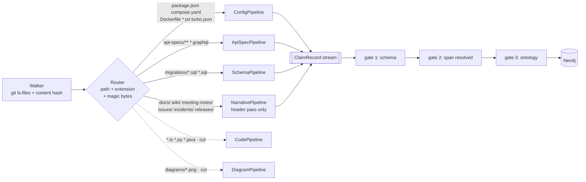

# 05 — Extraction pipelines

The 15-point area: *"how the solution ingests and extracts knowledge… including how
the extraction is automated and the ability to handle different formats."*

## One envelope, six pipelines — four ship

Every pipeline emits the same record. That single constraint is what makes four
developers able to work in parallel without meetings, and what makes a seventh source
type a pure addition.

Defined once in `apps/context-service/models/claim.py`; abridged:

```python
class EvidenceHint(BaseModel):    # extractor output, gate 2 input — never persisted
    path: str                     # relative to the submodule root
    start_line: int               # a hint: the gate searches the file if it is wrong
    excerpt: str

class Span(BaseModel):            # what gate 2 writes — a pointer, no prose
    path: str
    start_line: int
    end_line: int                 # derived from the excerpt's newlines, never trusted
    content_hash: str             # sha256 of the file the excerpt was found in

class ExtractedClaim(BaseModel):  # what every pipeline emits
    subject: EntityRef            # {kind, key}  e.g. {"kind":"Service","key":"inventory-service"}
    predicate: Predicate          # closed enum from the ontology
    object: EntityRef
    polarity: Polarity            # ASSERTS | NEGATES
    modality: Modality            # FACT | DECISION | PROPOSAL | PLAN | HYPOTHESIS | PROHIBITION
    evidence: list[EvidenceHint]  # ≥ 1, always
    time_evidence: EvidenceHint | None  # dates an undated file: the release that shipped it
    confidence: float             # 0..1, the extractor's own
    extractor: str                # "narrative.header"
    extractor_version: str        # bump invalidates the cache for that pipeline only

class ClaimRecord(...):           # after gates + dating: same fields, plus
    id: str                       # content-derived
    evidence: list[Span]
    source_type: SourceType       # from the path — decides authority
    declared_status: DocStatus | None    # header pass: "proposed", "deferred", …
    modality_capped_from: Modality | None  # set when the header capped a DECISION
    observed_at / valid_from: date | None
    observed_precision / valid_from_precision: "day" | "month"
    time_signal: TimeSignal       # which row of 04's table produced the date
```

`valid_to` and `valid_to_precision` are not extracted: only the resolver can close a
claim, so they live on `ResolvedClaim` ([04](04-temporal-model.md#resolution-algorithm)).
A diagram `Span` points at the PNG, but its lines index the reviewed transcription in
`data/fixtures/diagrams/<stem>.json` and its hash is that file's.

**Storage is referential.** `excerpt` exists only long enough for gate 2 to verify it
and is then dropped; the graph stores the pointer plus the file hash. `Chunk.text`
exists because embeddings need bytes, and it is rebuildable, never cited.



Solid edges ship; dashed pipelines are documented forward work ([ADR-0006](adr/0006-scope-of-the-build.md)).

Routing is by path convention first, extension second, magic bytes last. Path first
because in this corpus the path *is* semantics: `api-specs/history/` and `archive/`
carry a deprecation signal that no file-content inspection would recover
([01 — T3, T5](01-corpus-survey.md#t3--superseded-api-contract)).

## Incremental by construction

Cache key: `sha256(file_bytes) + extractor_version`. A file whose content hash is
unchanged and whose pipeline version is unchanged costs **zero** — no parse, no
model call, no embedding. Two identical files anywhere in the corpus share one
extraction. This is the standard content-addressed pattern
([sources](research/sources.md#incremental-etl)), and it is what turns "re-index the
corpus" from a batch job into something that runs on save.

It also makes the pipeline **idempotent**: claim IDs are derived from
`hash(subject, predicate, object, span, extractor_version)`, so re-running produces
`MERGE`, never duplicates. Re-running the whole ETL is always safe, which is the
property that lets four developers run it constantly during a five-hour build.

## The pipelines — four ship, two are forward work

### CodePipeline — `apps/**`, `packages/**`

tree-sitter grammars for TypeScript, TSX, JavaScript, Python and Java. One query
file per language, run against the AST; no language server, no build.

Extracts: module/symbol definitions · imports (→ `IMPORTS`, `DEPENDS_ON`) · HTTP
route registrations and fetch/axios call sites (→ `EXPOSES`, `CALLS`) · SQL strings
and ORM calls (→ `READS_FROM`, `WRITES_TO`) · `process.env` / `os.environ` reads
(→ `EnvVar`) · port literals (→ `LISTENS_ON`) · auth middleware presence per route
(→ feeds the risk pipeline).

`confidence: 0.9`, `modality: FACT`. The known weakness is dynamic dispatch and
string-built URLs, which tree-sitter cannot follow; those become `MENTIONS` rather
than `CALLS`, which is the conservative failure.

**Security sub-extractor.** Semgrep-style AST patterns for the shapes the corpus
plants: a route handler that reads an owner-scoped resource without comparing the
caller identity (CWE-639, the SEC-22 shape), hardcoded secrets, disabled TLS
verification, raw string SQL concatenation. Each emits a `Risk` node with a CWE id
and a span. Static analysis is pattern-matching, so false positives are expected and
the finding stays `DISPUTED` until a second source corroborates — the published
limitation of SAST tooling is exactly this ([sources](research/sources.md#semgrep)).

### ConfigPipeline — manifests and deployment

Pure deterministic parsing, **authority 1.00**, no model, and by volume the single
highest-value pipeline in the system.

`package.json` → workspace membership, dependency edges, scripts.
`requirements.txt` → Python deps. `compose.yaml` → services, profiles, port
mappings, env vars, `depends_on`. `Dockerfile*` → base images, build args.
`config/ports.json` → the authoritative service→port map.
`turbo.json`/`pnpm-workspace.yaml` → **the workspace boundary**, which is what
separates `archive/` from the active system and resolves trap T5 without a model.
`.github/CODEOWNERS` → `OWNS` edges, i.e. the rubric's *"who owns a component"*.

### ApiSpecPipeline — `api-specs/**`, `*.graphql`

OpenAPI JSON → `Endpoint` nodes (method, path, params, response schema), versions,
and `IMPLEMENTS` links to the handlers found by CodePipeline. GraphQL SDL →
types and fields. Any file under `history/` is tagged `DEPRECATED` at extraction
time by path rule, and a `SUPERSEDES` edge is written from the current spec to it.

This pipeline produces the **gap detector for free**: an endpoint in a spec with no
matching handler is a documented-but-unimplemented gap; a handler with no spec entry
is an undocumented endpoint. Both are exactly the "fills the gaps" ask in the brief,
and both fall out of set difference rather than inference.

### SchemaPipeline — `migrations/*.sql`, `*.sql`

`sqlglot` AST, not regex, because the interesting statements are `ALTER`s. Produces
`Table`/`Column` nodes **with migration-ordered validity**:
`002-account-tiers.sql` closes `users.status` and opens `users.account_status` and
`users.customer_tier`. That is trap T2 resolved mechanically, with a confidence of
1.0, by a pipeline with no model in it. Also emits `SHARES_SCHEMA_WITH` when two
services reference the same table — carefully scoped to the workspace so the
facilities-tracker `Inventory` table does not join the product catalogue.

### NarrativePipeline — `docs/`, `wiki/`, `meeting-notes/`, `issues/`, `incidents/`, `releases/`

The only pipeline where a general-purpose model is doing the core work, and it is
structured so the model does as little as possible:

1. **Deterministic header pass** — `Date:`/`Status:` fields, filename dates, bylines,
   issue status. Covers signals 1–3 in
   [04](04-temporal-model.md#where-time-comes-from) with no model. The declared status
   (`ingest/headers.py`, shared by every source type) sets `settledness` and caps any
   `DECISION` from an unsettled document — see
   [04](04-temporal-model.md#one-rule-set-for-every-kind-of-source).
2. **Structure-aware chunking** — split on heading boundaries, target 400–600 tokens.
   The 2026 benchmarks are counter-intuitive here: recursive splitting at ~512 tokens
   beats semantic chunking on end-to-end accuracy (69% vs 54%) despite semantic
   chunking winning on raw recall ([sources](research/sources.md#chunking)). We take
   the boring option, deliberately.
3. **Contextual prefix** — each chunk is stored with its heading path and document
   title prepended before embedding (Anthropic's contextual-retrieval pattern), which
   is a consistent gain for a one-time indexing cost.
4. **Constrained claim extraction** — one model call per chunk, with the
   `ClaimRecord` JSON Schema passed as Ollama's `format` constraint, so the output is
   structurally valid by construction rather than by retry
   ([sources](research/sources.md#ontology-guided-extraction)). The prompt carries the
   closed predicate list and requires a verbatim `excerpt` for every claim.
5. **Modality classification** — the six-way call from
   [04](04-temporal-model.md#where-time-comes-from), signal 8.

Gate 2 does the quality control: a local 7–8B model will hallucinate predicates and
subjects, and roughly every claim it invents fails the verbatim-excerpt check. We
expect to discard a meaningful fraction of generated claims and consider that the
system working, not failing.

### DiagramPipeline — `diagrams/*.png`

Six images. The corpus's own README says their content matters: *"A drawn connection
can be useful evidence without proving an executable call path."*

Two-stage extraction, following the Ariadne decomposition
([sources](research/sources.md#vlm-diagrams)): **(a)** node inventory — list every
labelled box; **(b)** source-conditioned edge prediction — for each node, list its
outgoing edges and labels. Decomposition markedly outperforms asking for the whole
topology in one shot.

**And then we do not trust the result.** The published numbers are blunt: the best
model on the SADU software-architecture-diagram benchmark reaches ~70% accuracy, and
frontier VLMs fall below 60% on structured engineering diagrams
([sources](research/sources.md#vlm-diagrams)). A local VLM will do worse. Therefore:

- `authority` capped at 0.40 — diagram claims never outrank code or config.
- A diagram claim is promoted to `VALID` **only when corroborated** by a non-diagram
  source. Alone, it stays `DISPUTED` and is reported as "the September diagram shows
  this; nothing else does" — which is itself a useful finding.
- Six images is small enough that each extraction is **human-reviewed once** and
  committed as a fixture under `data/fixtures/diagrams/*.json` with
  `extractor: "vlm+human"`. This is honest about our model access, costs twenty
  minutes, and is exactly what a real deployment would do at the sampling rate the
  accuracy numbers justify.

The diagram value is not the nodes — code gives better nodes. It is `architecture-january`
vs `architecture-september`: **a visible delta with dates on it**, which is a strong
temporal signal for the resolver and the cleanest demo of the whole thesis.

## Automation

One command, incremental, idempotent, and the same command in CI:

```sh
ncs ingest                 # walk → route → extract → validate → load
ncs ingest --since HEAD~1  # only blobs changed by the last commit
ncs resolve                # entity resolution → temporal → conflicts → communities
ncs verify                 # re-check every span against disk; report drift
```

`ncs verify` is **not built** ([ADR-0006](adr/0006-scope-of-the-build.md)) but remains the maintenance story for [Forward View](09-evaluation.md#forward-view):
because every claim is pinned to `(path, lines, content_hash)`, a nightly job can
prove the index still matches the repository and flag exactly which claims a merge
invalidated. The service can detect its own staleness — which, for a system whose
entire purpose is detecting staleness, is the minimum bar.
