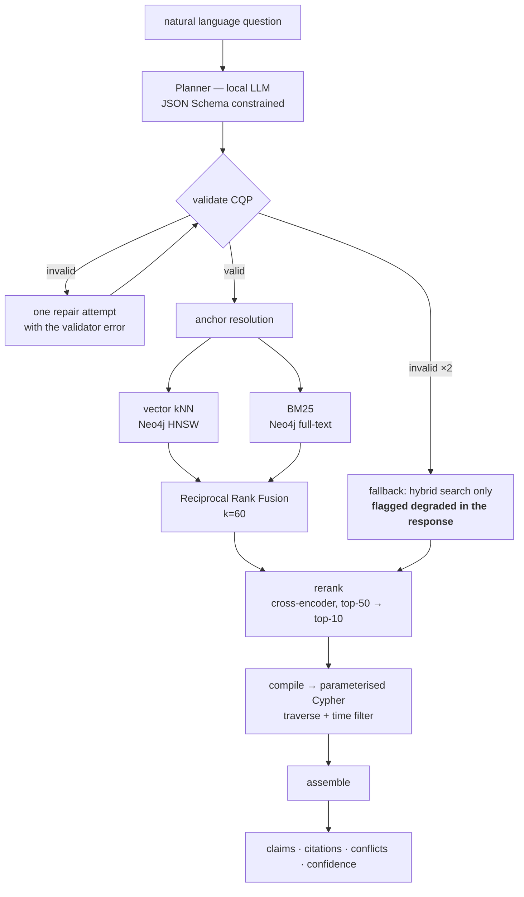

# 06 — Retrieval and the Context Query Plan

The requirement: *the user query must be translated into concrete, error-proof
instructions to query context.*

## The position: the model never writes a query

The 2026 Text2Cypher literature is consistent — generated Cypher fails on syntax and
on schema mismatch, and the state of the art is a stack of mitigations (grammar
filtering, schema filtering, confidence decoding, execution validation, self-refinement
loops) bolted on to make it *tolerable* ([sources](research/sources.md#text2cypher)).

Every one of those mitigations exists to recover from the same root cause: the model
was given an unbounded output space. So we do not give it one.

> The planner emits a **Context Query Plan** — a JSON object validated against a JSON
> Schema. A deterministic compiler turns a valid plan into parameterised Cypher drawn
> from a fixed template library. No model-authored Cypher ever reaches the database.

What this buys:

- **Error-proof by construction.** An invalid plan is caught by a schema validator
  before anything executes. There is no such thing as a syntax error reaching Neo4j.
- **Bounded blast radius.** Templates are read-only, parameterised, hop-capped and
  row-capped. Cypher injection is not mitigated; it is absent.
- **Testable without a model.** The compiler is pure. Plans are fixtures. The entire
  query layer has unit tests that run in milliseconds — which matters enormously when
  four people are integrating under time pressure.
- **Swappable planner.** A 7B local model, a frontier model, or a hand-written plan
  from a `curl` all enter through the same door.
- **Degrades honestly.** If the planner fails twice, we fall back to hybrid search
  and *say so* in the response, rather than executing a guess.

The cost: expressiveness. A question whose shape has no template cannot be answered
exactly. We consider that the right trade — an honest "I have no way to answer that
precisely, here is hybrid search" beats a confidently wrong traversal, especially for
a system whose whole pitch is trustworthiness.

## The CQP schema

```jsonc
{
  "cqp_version": "1.0",
  "intent": "IMPACT_OF_CHANGE",        // closed enum, 7 values
  "anchors": [                          // what to find first
    {"kind": "Service", "key": "inventory-service", "match": "exact"},
    {"kind": "ANY", "text": "stock cache", "match": "hybrid"}
  ],
  "traverse": {
    "predicates": ["CALLS", "READS_FROM", "DEPENDS_ON"],
    "direction": "BOTH",
    "max_hops": 2,                      // hard-capped at 3 by the compiler
    "max_nodes": 50
  },
  "time": {
    "as_of": "now",
    "status_in": ["VALID", "DEPRECATED"],
    "include_superseded_chain": true
  },
  "evidence": {
    "min_confidence": 0.5,
    "require_citations": true,
    "max_spans_per_claim": 2
  },
  "output": {"token_budget": 2000, "include_conflicts": true}
}
```

Seven intents, each mapping to exactly one compiler template:

| Intent | Question shape | Template |
|---|---|---|
| `LOOKUP` | "what is X" | anchor + 1-hop + claims |
| `STATE_OF` | "does X still use Y" | anchor + predicate filter + full status history |
| `RELATIONSHIP` | "how do X and Y connect" | bidirectional shortest paths ≤3, all evidence |
| `IMPACT_OF_CHANGE` | "what breaks if I change X" | reverse-dependency closure + risks |
| `CONFLICTS` | "what disagrees about X" | `CONTRADICTS` subgraph, both sides |
| `TIMELINE` | "how did X change" | all claims about X ordered by `valid_from` |
| `RISKS` | "what's unsafe in X" | `Risk` subgraph + corroboration status |

The planner's entire job is: pick one of seven intents, extract anchors, set a time
filter. That is a *classification and slot-filling* task, which is what small local
models are actually good at — as opposed to generating a correct graph query against
a schema they half-remember.

## Retrieval pipeline



**Hybrid, not vector-only, and not negotiable here.** BM25 is what finds `REDIS_URL`,
`cus-001`, `account_status`, `5005` and `PaymentService` — exact tokens that dense
embeddings blur. Hybrid with RRF is the documented minimum viable baseline, worth
15–30% recall over single-method retrieval, and cross-encoder reranking on top of RRF
dominates everything else measured ([sources](research/sources.md#hybrid-retrieval)).
In a corpus whose distinguishing features are identifiers, this is the difference
between working and not.

RRF needs no score normalisation, which is why it is the right fusion for mixing a
Lucene score with a cosine distance: `score(d) = Σ 1/(60 + rank_i(d))`.

**Reranking.** A cross-encoder over the top ~50 fused candidates. If the local
reranker proves too slow inside the 5-hour build, the degradation is graceful: RRF
order is already decent, and we record the omission rather than pretending.

## Answer assembly

The output format is the product. Every response is a list of claims, never prose
with footnotes bolted on:

```jsonc
{
  "answer": "No. The Redis read cache was removed from the stock path on 2026-06-04.",
  "claims": [
    {
      "statement": "inventory-service reads availability directly from SQLite",
      "status": "VALID", "valid_from": "2026-06-04", "valid_to": null,
      "confidence": 0.96,
      "citations": [
        {"path": "docs/adr/003-stock-cache.md", "lines": [6,6],
         "excerpt": "Remove Redis from the local inventory path."},
        {"path": "releases/2026-06-v1.3.md", "lines": [5,5],
         "excerpt": "Removed the Redis path and REDIS_URL..."},
        {"path": "apps/inventory-service/app.py", "lines": [41,58]}
      ],
      "corroborated_by": 3
    },
    {
      "statement": "Core Platform owns Stock and its Redis read cache",
      "status": "DEPRECATED", "valid_from": "2026-01-01", "valid_to": "2026-06-04",
      "superseded_by": "docs/adr/003-stock-cache.md",
      "citations": [{"path": "wiki/inventory-service.md", "lines": [5,5]}],
      "note": "Stale documentation — accurate when written."
    }
  ],
  "conflicts": [],
  "gaps": ["No test covers the post-removal availability path."],
  "degraded": false
}
```

Three deliberate properties:

1. **The deprecated claim is returned, not hidden.** An engineer who just read the
   wiki needs to know why it disagrees. Suppression would produce a service that
   seems to contradict the documentation for no stated reason.
2. **`citations` is structural** — path plus line range plus the verbatim excerpt that
   passed gate 2. Never a title, never a paraphrase. This is the AGENTS.md invariant
   and the rubric's "evidence-backed" in literal form.
3. **`gaps` and `degraded` are first-class.** Reporting what is *missing* and
   reporting when the service is operating below spec are both part of the brief, and
   both are easy to quietly omit.

## Context budget

The 2026 context-engineering evidence is that more retrieved context makes agents
worse, not better: accuracy degrades as the window fills, and just-in-time retrieval
that keeps context small measurably improves accuracy and speed
([sources](research/sources.md#context-engineering)). So `token_budget` is enforced,
not advisory, and spending is ranked:

1. The answer sentence.
2. One citation per `VALID` claim.
3. Conflicts (both sides, one citation each).
4. Additional corroborating citations.
5. Deprecated-claim detail.

When the budget binds, the response carries `truncated: true` and a `continue_token`.
**The service returns the smallest sufficient answer, not everything it knows.** A
Context Service that floods the window is just a slower `grep`.
