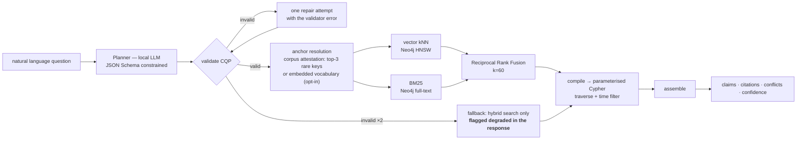

# 06 — Retrieval and the Context Query Plan

The requirement: *the user query must be translated into concrete, error-proof
instructions to query context.*

## The position: the model never writes a query

The 2026 Text2Cypher literature is consistent — generated Cypher fails on syntax and
on schema mismatch, and the state of the art is a stack of mitigations (grammar
filtering, schema filtering, confidence decoding, execution validation, self-refinement
loops) bolted on to make it *tolerable* ([sources](research/sources.md#text2cypher)).

Every one of those mitigations exists to recover from the same root cause: the model
was given an unbounded output space. So we do not give it one.

> The planner emits a **Context Query Plan** — a JSON object validated against a JSON
> Schema. A deterministic compiler turns a valid plan into parameterised Cypher drawn
> from a fixed template library. No model-authored Cypher ever reaches the database.

What this buys:

- **Error-proof by construction.** An invalid plan is caught by a schema validator
  before anything executes. There is no such thing as a syntax error reaching Neo4j.
- **Bounded blast radius.** Templates are read-only, parameterised, hop-capped and
  row-capped. Cypher injection is not mitigated; it is absent.
- **Testable without a model.** The compiler is pure. Plans are fixtures. The entire
  query layer has unit tests that run in milliseconds — which matters enormously when
  four people are integrating under time pressure.
- **Swappable planner.** A 7B local model, a frontier model, or a hand-written plan
  from a `curl` all enter through the same door.
- **Degrades honestly.** If the planner fails twice, we fall back to hybrid search
  and *say so* in the response, rather than executing a guess.

The cost: expressiveness. A question whose shape has no template cannot be answered
exactly. We consider that the right trade — an honest "I have no way to answer that
precisely, here is hybrid search" beats a confidently wrong traversal, especially for
a system whose whole pitch is trustworthiness.

## The CQP schema

```jsonc
{
  "cqp_version": "1.0",
  "intent": "STATE_OF",                 // closed enum, 6 values
  "anchors": [                          // what to find first
    {"kind": "Service", "key": "inventory-service", "match": "exact"},
    {"kind": "ANY", "text": "stock cache", "match": "hybrid"}
  ],
  "traverse": {
    "predicates": ["CALLS", "READS_FROM", "DEPENDS_ON"],
    "direction": "BOTH",
    "max_nodes": 50                   // the only blast-radius cap: every template LIMITs rows
  },
  "time": {
    "as_of": "now",
    "status_in": ["VALID", "DEPRECATED"],
    "include_superseded_chain": true
  },
  "evidence": {
    "min_confidence": 0.5,
    "require_citations": true,
    "max_spans_per_claim": 2
  },
  "output": {"token_budget": 2000, "include_conflicts": true}
}
```

Six intents, each mapping to exactly one compiler template:

| Intent | Question shape | Template |
|---|---|---|
| `LOOKUP` | "what is X" | anchor + 1-hop + claims |
| `STATE_OF` | "does X still use Y" | anchor + predicate filter + full status history |
| `RELATIONSHIP` | "how do X and Y connect" | anchor + predicate filter, one hop, all evidence |
| `CONFLICTS` | "what disagrees about X" | `CONTRADICTS` subgraph, both sides |
| `TIMELINE` | "how did X change" | all claims about X ordered by `valid_from` |
| `RISKS` | "what's unsafe in X" | anchor OR `VIOLATES`/`PROHIBITS` predicate, anchored claims first |

The planner's entire job is: pick one of six intents, extract anchors, set a time
filter. That is a *classification and slot-filling* task, which is what small local
models are actually good at — as opposed to generating a correct graph query against
a schema they half-remember.

An anchor resolves against the claim's subject entity key **or its object**, so a port
(`5005`), an identifier (`REDIS_URL`) or a path resolves without being an entity. What
does not appear in either place cannot be found: a question whose only distinctive token
is a concept returns an honest empty answer, never a guess.

## Anchors: which words in the question are real

A question arrives in English, a corpus arrives in its own vocabulary, and the gap
between them is where hand-written word lists go to die. Two mechanisms exist, and the
default is the one that measured better:

| Mechanism | How | Seven traps |
|---|---|---|
| **Corpus attestation** (default) | Every candidate token is checked against real `Entity.key`s (`_ATTEST`); a token no key contains is dropped, and the survivors are ranked by how few entities they name — specificity as IDF, computed from this corpus, no stopword list | **7/7** |
| **Embedded vocabulary** (`ETYT_VOCAB_RESOLVE=1`) | `graph/vocab.py` embeds every entity key and every predicate gloss at `cli index` time; the question is embedded once and compared by cosine, names before paths | **4/7** |

Why the weaker one ships enabled: the measurable set is seven questions about one corpus,
and on that corpus the keys already contain the words the questions use, so a thesaurus
adds noise — it pulled in `user-service` and `users` for "people and accounts" and buried
the `employee-sso` claim that G6 asserts. The resolver earns its flag on the other corpus:
questions that use a synonym no identifier shares, or a corpus in another language.

Two rules make either path safe, and they are why this is not a model writing queries:
predicates come only from the closed `PREDICATE_GLOSSES`/`PREDICATE_CUES` vocabulary (an
OR-filter over a wrong guess deletes the right answer — measured, `AUTHENTICATES_VIA`
emptied the SSO question), and an anchor survives only if the graph has that key.

## Two layers, because most of a corpus is not a claim

| layer | what it holds | verified by | carries a status |
|---|---|---|---|
| `claims` | triples the extractors produced (284) | span appears verbatim at the cited lines | yes — `VALID`, `DEPRECATED`, `DISPUTED`, `PROPOSED` |
| `evidence` | verbatim passages (any of 897 chunks) | file hash and line range | **no** — quoted text is not a verdict |

A question that matches no claim is still answered: the passage layer returns cited prose,
bounded by `effort`, with `heading_path` so a client can walk file → section → passage.
Retrieval has always found those chunks; before ADR-0011 the envelope had nowhere to put
them and rendered them as a sentence in `gaps`.

A passage must also earn its place, and the measurement says how:

| signal | verdict |
|---|---|
| shares a content word with the question | evidence |
| found by **both** channels (keyword *and* meaning) | evidence |
| found by meaning alone | **not** evidence |
| structural noise by shape (`EVIDENCE_MIN_CHARS`, `EVIDENCE_MIN_RATIO`) | not evidence |

Measured: chunk cosine does not separate the two — the top hits for *"how does the console
handle exceptions"* and for *"what cases are we covering"* both score 0.75–0.79, because
`nomic-embed-text` places almost everything near 0.76. A score threshold cannot be the gate,
so meaning alone never is: it needs corroboration from a term, which is the same rule that
keeps "topically nearest" from being mistaken for "true".

## How hard to look: `effort`

The plan carries `effort: int 0..4`, semi-automatic. The planner starts at 1 when the
question names an identifier and 2 when it names nothing; a caller may pin any level
(`POST /v1/query` takes `effort`, the MCP tools take `effort`).

Each level pays for a wider search of the embedded claim statements and caps what it
returns:

| effort | claim-vector k | max claims added | promised total |
|---|---|---|---|
| 0 | 0 | 0 | graph only |
| 1 | 8 | 2 | 1 (auto: named question) |
| 2 | 16 | 3 | 2 (auto: unnamed question) |
| 3 | 32 | 4 | 2 |
| 4 | 64 | 5 | 3 |

Measured on the live stack, `"what cases are we covering"` — a question whose subject the
extractors never produced — returns 0, 2, 3, 4, 5 claims for efforts 0–4.

Two properties make the knob safe rather than a quality dial:

- **Gates do not relax.** Status, time, confidence and the span check run identically at
  every level. More effort can surface *more evidence*; it can never surface *weaker
  evidence*, so a higher number cannot turn a `DEPRECATED` claim into a `VALID` one.
- **An unmet promise is reported.** If the corpus cannot support the count, the answer says
  how many were added and stops; it never pads with unrelated rows. The similarity scores
  are flat (0.72–0.84), which is why the cap, not a score threshold, is the real control.

## Retrieval pipeline



**Hybrid, not vector-only, and not negotiable here.** BM25 is what finds `REDIS_URL`,
`cus-001`, `account_status`, `5005` and `PaymentService` — exact tokens that dense
embeddings blur. Hybrid with RRF is the documented minimum viable baseline, worth
15–30% recall over single-method retrieval ([sources](research/sources.md#hybrid-retrieval)).
Cross-encoder reranking on top of RRF measures better and is **not built**: it is
forward work ([ADR-0006](adr/0006-scope-of-the-build.md)), so the recall target is set
for the pipeline that actually ships. In a corpus whose distinguishing features are
identifiers, hybrid versus vector-only is the difference between working and not.

RRF needs no score normalisation, which is why it is the right fusion for mixing a
Lucene score with a cosine distance: `score(d) = Σ 1/(60 + rank_i(d))`.

**Reranking — not built.** A cross-encoder over the top ~50 fused candidates measures
better, but it is cut by [ADR-0006](adr/0006-scope-of-the-build.md). RRF order is what
ships, and the recall target in [09](09-evaluation.md#component-level-checks) is set
accordingly. Recorded as forward work, not as a silent omission.

## Answer assembly

The output format is the product. Every response is a list of claims, never prose
with footnotes bolted on:

```jsonc
{
  "answer": "inventory-service reads availability directly from SQLite. Superseded: Core Platform owns Stock and its Redis read cache.",
  "detail": "medium",
  "claims": [
    {
      "statement": "inventory-service reads availability directly from SQLite",
      "status": "VALID", "valid_from": "2026-06-04", "valid_to": null,
      "confidence": 0.96, "superseded_by": null,
      "citations": [
        {"path": "docs/adr/003-stock-cache.md", "lines": [6,6], "hash": "9e1c…"},
        {"path": "apps/inventory-service/app.py", "lines": [61,85], "hash": "c07d…"}
      ],
      "why_not_valid": null,
      "id": "c1f0…", "subject": "inventory-service", "predicate": "REQUIRES", "polarity": "ASSERTS"
    },
    {
      "statement": "Core Platform owns Stock and its Redis read cache",
      "status": "DEPRECATED", "valid_from": "2026-01-01", "valid_to": "2026-06-04",
      "confidence": 0.62,
      "superseded_by": "docs/adr/003-stock-cache.md",
      "citations": [{"path": "wiki/inventory-service.md", "lines": [5,5], "hash": "41ab…"}],
      "why_not_valid": "superseded by docs/adr/003-stock-cache.md on 2026-06-04",
      "id": "c2a7…", "subject": "Core Platform", "predicate": "OWNS", "polarity": "ASSERTS"
    }
  ],
  "conflicts": [],
  "gaps": ["No test covers the post-removal availability path."],
  "degraded": false,
  "evidence": []
}
```


Five deliberate properties:

1. **How much of this shape you get is the request's `detail`** — `low` is the answer, the
   claims and one citation each; `high` adds the quoted lines, extractor provenance and the
   executed plan ([07](07-api-and-mcp.md#effort-and-detail-are-two-different-promises)).

2. **The deprecated claim is returned, not hidden.** An engineer who just read the
   wiki needs to know why it disagrees. Suppression would produce a service that
   seems to contradict the documentation for no stated reason.

3. **A citation of an image is a region, not a line** — `region: [x, y, w, h]` in pixels from
   the top-left, with `lines: [1, 1]` as the sentinel. Verification is geometric: the rectangle
   must lie inside the bitmap's real dimensions (read from the PNG header) and the file's digest
   must match. A region claim quotes no text, because there is no text to quote verbatim.
4. **`citations` are referential** — path, line range, and the file hash the range was
   verified against. Never a title, never a paraphrase, and never stored prose: the
   caller resolves the text with `GET /v1/span?path=&start=&end=` (or the
   `resolve_span` MCP helper), which re-checks the hash before returning bytes. This is
   the AGENTS.md invariant and the rubric's "evidence-backed" in literal form, and it
   keeps the graph free of duplicated text.
5. **`gaps` and `degraded` are first-class.** Reporting what is *missing* and
   reporting when the service is operating below spec are both part of the brief, and
   both are easy to quietly omit. Search reports per channel (`ok` / `empty` / `error`),
   so a dead vector index surfaces as `Search channel unavailable: vector` instead of
   looking identical to a healthy lexical one. `degraded` stays reserved for the case
   where the answer actually got smaller.

## Context budget

The 2026 context-engineering evidence is that more retrieved context makes agents
worse, not better: accuracy degrades as the window fills, and just-in-time retrieval
that keeps context small measurably improves accuracy and speed
([sources](research/sources.md#context-engineering)). So `token_budget` is enforced,
not advisory, and spending is ranked:

1. The answer sentence.
2. One citation per `VALID` claim.
3. Conflicts (both sides, one citation each).
4. Additional corroborating citations.
5. Deprecated-claim detail.

When the budget binds, the response carries `truncated: true` and a `continue_token`.
**The service returns the smallest sufficient answer, not everything it knows.** A
Context Service that floods the window is just a slower `grep`.
