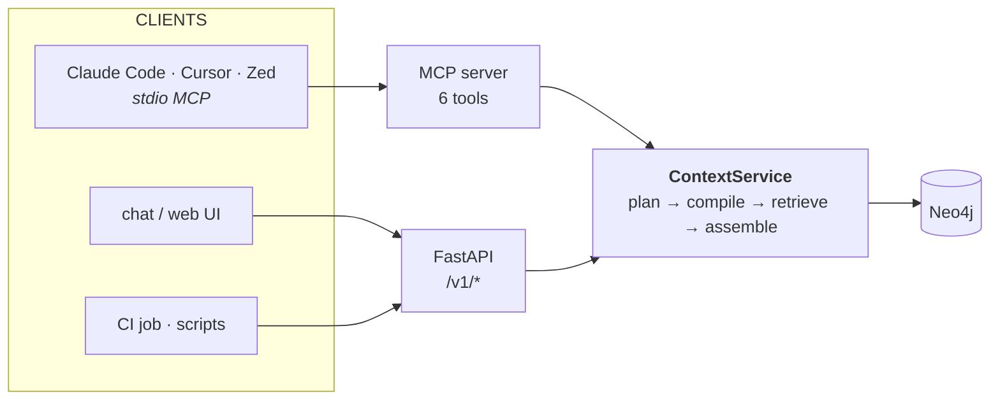

# 07 — API and MCP surface

The 15-point area: *"how effectively the Context Service can be used by humans, IDEs,
and agentic AI coding assistants, including access through MCP, APIs, or similar."*

## One service layer, two transports



The MCP server is a thin adapter over the same `ContextService` the REST API calls.
No logic lives in a transport. This is not tidiness for its own sake: it means MCP
tools are testable without an MCP client, which is the difference between a
demoable integration and one that breaks on stage.

## MCP tool design

MCP is a user interface for an agent, not a REST wrapper. The guidance that shapes
this surface ([sources](research/sources.md#mcp-design)): design top-down from what
the agent is trying to accomplish; keep the tool count small because tool schemas can
consume ~40% of an agent's tokens before it does anything; compute server-side and
return conclusions, not raw rows.

So: **three workflow tools**, one per CQP intent the demo actually exercises. Not
`get_node`, `list_edges`, `run_cypher`. Six were designed; three ship —
[ADR-0006](adr/0006-scope-of-the-build.md).

| Tool | For the agent's question | Returns |
|---|---|---|
| `context_search` | "what do we know about X?" | ranked claims + citations + status |
| `context_explain_relationship` | "how do A and B connect?" | paths, each hop with evidence and dates |
| `context_risks` | "what's unsafe here?" | risks + CWE + corroboration status + the safe pattern |

Shared parameters across all three: `as_of`, `status_in`, `token_budget`, `max_hops`.
An agent that learns one tool has learned all three. `context_conflicts`,
`context_timeline` and `context_impact_of_change` exist as CQP intents behind
`POST /v1/query` and are promoted to tools only when an agent needs them.

`context_risks` is the one that closes the loop on the brief's fourth scenario
(*"ensure that generated code does not repeat the same security risks"*). It does not
just report SEC-22; it returns the **prohibition** — the pattern to avoid and the
corpus evidence for avoiding it — in a form an IDE agent can act on before it writes
the handler.

### Tool responses are agent-shaped

Compact, deterministic key order, no decorative prose, token-budgeted
([06](06-retrieval.md#context-budget)). Every response carries `status`,
`confidence` and `citations`, so a downstream agent can decide *for itself* whether
to act — rather than receiving confident text and having to trust it.

## REST surface

```
POST /v1/query              { question, as_of?, status_in?, token_budget? }  → answer envelope
POST /v1/plan               { question }                                     → CQP (no execution)
POST /v1/execute            { cqp }                                          → answer envelope
GET  /v1/entity/{kind}/{key}?as_of=                                          → entity + claims
GET  /v1/entity/{kind}/{key}/timeline                                        → status history
GET  /v1/conflicts?scope=   (column 2)                                       → open contradictions
GET  /v1/span?path=&start=&end=                                              → verified bytes for a citation
GET  /v1/gaps?kind=         (column 2)                                       → undocumented / unimplemented
GET  /v1/sources/{path}                                                      → claims extracted from one file
GET  /healthz  /readyz  /v1/index/status                                     → ops
```

`/v1/plan` and `/v1/execute` are split deliberately: it makes the plan inspectable,
lets a human or a test fix a plan the planner got wrong, and turns
"show the judges how the query actually works" into a single `curl`.

`/v1/gaps` and `/v1/conflicts` are *corpus-wide* endpoints with no question attached.
They are the ones an engineering manager runs, and they are the strongest evidence
that this is a context service rather than a chatbot: *"here are the 14 wiki pages
your repository has outgrown."*

## Security

Two threats matter, and they point in opposite directions.

### 1. The corpus is untrusted input

Everything in `vendor/` is text that will end up inside an agent's context window.
Indirect prompt injection via retrieved content is the dominant agentic-RAG attack
class, and the baseline mitigation is unambiguous: **treat every retrieved chunk as
untrusted user input** ([sources](research/sources.md#prompt-injection)).

- Excerpts are returned inside explicit `<untrusted_source path="…">` delimiters.
- A deterministic scanner flags imperative-to-the-assistant patterns ("ignore
  previous instructions", "you are now…", "system:") in retrieved text and marks the
  span `suspicious: true` rather than silently stripping it — a seeded injection in
  an enterprise repo is itself a finding worth reporting.
- The planner sees **the user's question only**, never retrieved content. Retrieved
  text cannot influence which query runs. This is the structural defence, and it
  comes free from the CQP split in [06](06-retrieval.md).
- Tool outputs never carry executable instructions to the calling agent.

### 2. The service must not leak or mutate

- Neo4j credentials are read-only for the query path; only the ETL user writes.
- Templates are parameterised and read-only; there is no Cypher path from user input
  ([06](06-retrieval.md#the-position-the-model-never-writes-a-query)).
- The corpus contains synthetic secrets by design. The indexer **detects and
  classifies** them as `Risk` nodes but stores a redacted excerpt — the finding is
  "a hardcoded credential exists at this line", never the credential.
- MCP runs over stdio, local, unauthenticated-by-locality for the hackathon. A
  network deployment needs auth and per-tenant scoping; that is
  [Forward View](09-evaluation.md#forward-view), and it is named rather than assumed.

## IDE integration

```jsonc
// .mcp.json
{
  "mcpServers": {
    "northstar-context": {
      "command": "uv",
      "args": ["run", "ncs-mcp"],
      "env": {"NEO4J_URI": "bolt://localhost:7687"}
    }
  }
}
```

The demo that makes the 15 points real: in the IDE, ask *"add a cache to the stock
read path"*. Without the service, an agent reads `wiki/inventory-service.md`, finds
Redis, and reintroduces `REDIS_URL` — reversing a decision the team made in June.
With `context_search`, it gets ADR-003 with a `DEPRECATED` label on the wiki claim
and declines. **That is the product**, in one interaction, and it is a scenario the
corpus was built to contain.
