# 08 — Delivery plan: four developers, five hours

## The budget problem, stated plainly

Four developers × five hours = **20 developer-hours**, minus setup, minus
integration, minus the demo rehearsal. Realistically ~14 hours of productive build.

The design in documents 02–07 is a two-week system. It does not fit, and pretending
otherwise is how teams arrive at the demo with four half-finished branches and
nothing that runs.

So this plan does something specific: it **ships a narrow spine that proves the
thesis end to end**, and treats the rest of the design as the documented forward
path. That is not a compromise forced on us — it is the scoring-optimal move. 45 of
100 points are Presentation and Forward View, which reward a clearly explained
design; Knowledge Representation (25) is substantially won by
[03](03-ontology.md) and [04](04-temporal-model.md) existing and being coherent.
Extraction (15) and Connection (15) need *working* code, but working on a narrow
slice, not on everything.

**The one thing that must work on stage:** ask the service whether stock uses a Redis
cache, and watch it answer "no, removed 2026-06-04", cite ADR-003 and release 1.3,
and label the wiki page `DEPRECATED` — then watch an IDE agent decline to
reintroduce `REDIS_URL` because of it.

Everything below exists to make that true, honestly, from real extraction.

## Scope line

Frozen by [ADR-0006](adr/0006-scope-of-the-build.md). Column 1 is the build; column 2 is
the same lanes working faster, not extra scope; column 3 is a slide.

| Must ship (the spine) | Should ship (if ahead) | Will not ship (documented, not built) |
|---|---|---|
| Neo4j Community + uniqueness constraints | `/v1/gaps`, `/v1/conflicts` | L3 community layer |
| Config, Schema, ApiSpec pipelines | Security sub-extractor (`context_risks` corroboration) | Cross-encoder reranker |
| Narrative **header** pass (dates/status, no LLM) | Narrative LLM claim extraction | CodePipeline (tree-sitter) |
| Claim loader + gates 1–3 | `LOOKUP` + `TIMELINE` intents | DiagramPipeline VLM (fixtures instead) |
| Entity + temporal resolver steps 1–6, conflicts | OTel tracing | `IMPACT_OF_CHANGE` intent and tool |
| Hybrid search (vector + BM25 + RRF) | | Injection scanner, `ncs verify`, `--since` |
| CQP: `STATE_OF`, `RELATIONSHIP`, `CONFLICTS`, `RISKS` | | Auth, multi-tenant |
| MCP: 3 tools · REST `/v1/query`, `/v1/plan`, `/v1/span` | | |
| Golden set of 7 traps, green | | |

Anything in column 3 that a developer "just quickly adds" is a bug in this plan, not
a bonus. Say so out loud at the checkpoint.

## Contracts are loaded, not designed

They are written **before** the event — no corpus, no Neo4j and no model is needed for
any of them ([10](10-workstreams.md#the-four-contracts-frozen-before-the-event)). The first
30 minutes are for loading them into four checkouts and proving they agree:

1. `ClaimRecord` pydantic model ([05](05-extraction-pipelines.md#one-envelope-six-pipelines--four-ship)) — **frozen**.
2. `cqp.schema.json` ([06](06-retrieval.md#the-cqp-schema)) — **frozen**, six intents.
3. `answer.schema.json` ([06](06-retrieval.md#answer-assembly)) — **frozen**, referential citations.
4. `schema.cypher` — uniqueness constraints only, Community-safe ([03](03-ontology.md#storage-indexing-and-validation-in-neo4j)).
5. `data/fixtures/claims-sample.jsonl` — 30 hand-written ClaimRecords covering traps
   T1 and T2.

`docker compose up -d neo4j` must be green on all four laptops by 00:20; a laptop that
cannot start the store is found then, not at 02:40.

Item 5 is what actually buys the parallelism: with sample claims on disk, B, C and D
never wait for A's extractors. This is contract-first development applied to a data
pipeline ([sources](research/sources.md#contract-first)) and it is the only reason four
people on one five-hour system is not worse than two.

**A contract change after 00:20 requires all four to agree, in person.** A silent
envelope change is the failure mode that ends this.

## Workstreams

```mermaid
gantt
    dateFormat HH:mm
    axisFormat %H:%M
    title Five hours, freeze at 03:30
    section All
    Contracts loaded            :done, c, 00:00, 20m
    Checkpoint 1 (integrate)    :milestone, m1, 02:00, 0m
    Checkpoint 2 (feature freeze):milestone, m2, 03:30, 0m
    Demo rehearsal              :crit, dr, 03:30, 45m
    section A · Ingest
    Walker + router             :a1, 00:20, 40m
    ConfigPipeline              :a2, after a1, 60m
    SchemaPipeline              :a3, after a2, 45m
    Gate audit + integration    :a4, after a3, 35m
    section B · Knowledge
    Neo4j schema + loader       :b1, 00:20, 60m
    Entity resolution           :b2, after b1, 45m
    Temporal resolver 1–6       :crit, b3, after b2, 60m
    Conflict detection          :b4, after b3, 15m
    section C · Retrieval
    Embeddings + hybrid search  :c1, 00:20, 60m
    Wire prebuilt compiler      :crit, c2, after c1, 60m
    Templates + assembler       :c3, after c2, 60m
    section D · Edge + proof
    Fixtures + answer schema    :d1, 00:20, 40m
    REST skeleton               :d2, after d1, 60m
    FastAPI + MCP server        :crit, d3, after d2, 60m
    Golden set + demo script    :d4, after d3, 30m
```

### Dev A — Ingest and extraction
**Owns** `apps/context-service/ingest/`.
Walker (`git ls-files` + content hash), content router, `ConfigPipeline`,
`SchemaPipeline`, then the gate audit that proves every record passes 1–3. No tree-sitter, no VLM —
[ADR-0006](adr/0006-scope-of-the-build.md).
**Done when** `ncs ingest` writes a `claims.jsonl` whose every record passes gates 1–3,
including the `users.status → account_status` rename (trap T2) from the real migration.
**Depends on** nothing after minute 30. Hands off a file.

### Dev B — Knowledge representation and time
**Owns** `apps/context-service/graph/`.
Neo4j schema, claim loader (`MERGE` on derived id), entity resolution cascade,
**temporal resolver**, conflict detection.
**Done when** loading `claims-sample.jsonl` yields a graph where the Redis
relationship is `DEPRECATED` with `valid_to=2026-06-04` and a `SUPERSEDES` edge from
ADR-003 — and the wiki claim is still present and queryable.
**This is the critical path.** The resolver is where the system's whole argument lives.
If Dev B slips, everyone else has a working demo of a search engine.

### Dev C — Retrieval and query planning
**Owns** `apps/context-service/retrieval/`.
Embedding client (Ollama), chunker, hybrid search + RRF, CQP validator, compiler,
three templates, answer assembler with citations.
**Done when** `POST /v1/execute` with a hand-written CQP returns the T1 answer
envelope from [06](06-retrieval.md#answer-assembly), citations included.
**Note:** build the compiler before the planner. A working compiler with hand-written
plans is a complete demo; a planner with no compiler is nothing. If the local model
disappoints, we demo with stored plans and explain the split — which is a *stronger*
story about error-proofing, not a weaker one.

### Dev D — Edge, proof and presentation
**Owns** `apps/context-service/api/`, `tests/golden/`, the deck.
Diagram fixtures (hand-extract the six PNGs, 20 min), narrative header pass,
FastAPI, MCP server, golden-set harness, demo script, slides.
**Done when** Claude Code can call `context_search` and get the T1 answer, and
`pytest tests/golden` prints 7 rows with pass/fail per trap.
**Dev D owns the 35-point area.** That is deliberate: presentation is the largest
single block of marks, and assigning it to "whoever finishes first" is how teams lose
it. Dev D is building the thing being judged.

## Integration checkpoints

**Checkpoint 1 — 02:00. Integrate whatever exists.** Real claims from Dev A loaded by
Dev B, queried by Dev C, served by Dev D. It will be thin. That is fine; the point is
that the seams are proven while there is still time to fix them. Teams that integrate
at hour four discover their envelope mismatch at hour four.

**Checkpoint 2 — 03:45. Feature freeze.** No new capability after this. The remaining
75 minutes are integration, the golden set, and rehearsal. Anything incomplete is
`git stash`-ed and described as forward work, not demoed half-working.

## Demo script

Seven minutes, rehearsed twice, in this order — the first two minutes carry the marks.

1. **The problem, from the corpus** (45s). Show `wiki/inventory-service.md:5` and
   `docs/adr/003-stock-cache.md:6` side by side. "Both of these are in the repo. One
   is wrong. Nothing in the repository says which."
2. **Naive retrieval fails** (30s). Vector search for "stock cache" → the wiki page,
   ranked first, confidently.
3. **The service answers** (90s). `context_search` → "No, removed 2026-06-04", with
   ADR-003 + release 1.3 citations, the wiki claim labelled `DEPRECATED`, and the
   supersession chain.
4. **The IDE loop** (90s). In Claude Code: "add a cache to the stock read path."
   The agent calls the tool and declines, citing ADR-003.
5. **The ontology, in one slide** (60s). Three planes, four layers, why claims rather
   than triples.
6. **Time travel** (45s). Same question with `as_of: "2026-03-01"` → "yes, Redis."
   Same graph, different clock. This is the moment that lands the bi-temporal model.
7. **Limitations and forward view** (60s). Read from
   [09](09-evaluation.md#limitations). Naming our own weaknesses before a judge does
   is worth more than one more feature.

## Risk register

| Risk | Likelihood | Mitigation |
|---|---|---|
| Local model too slow/weak for claim extraction | **High** | Spine uses deterministic pipelines only. LLM extraction is in column 2. Fixtures guarantee a demo. |
| Temporal resolver (Dev B) slips | Medium | Fixtures let C and D finish regardless; A can take resolver steps 1–3 if idle at CP1. |
| Neo4j vector index setup burns an hour | Medium | Dev C validates it in the first 30 min, on real data, before building anything on it. |
| Envelope drift between A and B | Medium | One pydantic model, imported by both. Gate 1 fails loudly at the boundary. |
| Scope creep into column 3 | **High** | Checkpoint 2 is a hard stop. Column 3 is a *slide*, not a branch. |
| Demo machine has no Neo4j / no Ollama | Low | Rehearse on the actual demo machine before 04:15, not on a laptop that works. |

## Implementation plan — diagram evidence (ADR-0012, ADR-0013)

**Status 2026-11-08: phases 3a, 3b and the text half of 3c are built and verified.**
`orders.total HAS_DECLARED_TYPE REAL (USD)` is answered from
`customer-orders-erd.png` region `[628, 336, 193, 26]`; the 284 pre-existing claim ids are
untouched; a version bump removed 112 stale claims. **Open:** connector geometry (0-2 of ~8
edges measured), the region-aware `/v1/span` and MCP `resolve_span`, and the GUI rectangle.

Phases 0-2 are done: the owner approved the stack, three researches landed
(`research/diagram-extraction-fusion.md`, `research/licence-boundary.md`, the six-image
inventory), and two reviewers attacked the plan. What follows is the build, phase by phase.
**Each phase states its tests first**; a phase is done when its gate shows output, not when its
code compiles. Phases 3a and 3b are independent and run in parallel; 3c needs both.

### Corrections measured against the live store before any code

An independent review ran the plan's own Cypher against `etyt-neo4j-1` and found that the first
version of this phase could not land a single region claim. These are now part of the contract:

1. **A nullable merge aborts the load.** `MERGE … {region: null}` raises *Cannot merge the following
   node because of null property value*; all 311 claims are region-less, so one null kills the
   `UNWIND`. Two branches: the existing 3-property identity for line spans, a 7-property identity
   (`path, start_line, end_line, region_x, region_y, region_w, region_h`) for regions.
2. **A nested map is not a property.** `SET n.region = {x,y,w,h}` is rejected; store four flat
   integers. `schema.cypher` gains the matching assertion.
3. **Gate 2 drops region claims.** `ingest/gates.py:70-118` requires the excerpt verbatim in a
   UTF-8 read; a PNG cannot satisfy it. A region span carries `excerpt = None`, and gate 2's region
   leg is *file hash + bounds*.
4. **Bounds need a decoder.** A PNG's `IHDR` gives width and height in bytes 16-24; `sources.py`
   reads those 24 bytes, stdlib only. Out-of-bounds raises, never clamps.
5. **Two dedupe keys collapse regions.** `retrieval/service.py:355` and `:484` key on
   `(path, start, end)`; both gain the region.
6. **Sorted output, not insertion order.** `cli.py:200-210` writes insertion order, so
   "byte-identical" is already true and proves nothing; sort before writing and assert sorted.
7. **Out of 3a on purpose:** the walker's `claimable` only honours gated pipelines
   (`ingest/registry.py:419-421`), `graph/chunks.py` never chunks a PNG, `settings.PREDICATES` has
   no diagram predicate, and `/v1/span` + MCP `resolve_span` are line-only. Those are phase 3c.

### Phase 3a — the citation contract (no new image dependency)

Files: `models/claim.py`, `graph/loader.py`, `graph/schema.cypher`, `retrieval/cqp.py`,
`retrieval/service.py`, `retrieval/hybrid.py` (the passage shape at `_chunk`), `ingest/gates.py`,
`etynt_gui/src/App.tsx`
(citations are keyed `${path}:${lines[0]}`, which collides for two regions of one image, and the
drawer renders text where an image needs a rectangle), `docs/06`, `docs/07`.

Tests first, each anchored in a use case:

| test | use case |
|---|---|
| `Region(1,2,10,20)` on a claim changes `claim_id`; the same claim without a region keeps its exact id | the 284 extracted + 27 fixture claims must not churn |
| two claims, same triple, same image, different regions → two `Span` nodes and two citations | one diagram can state one fact twice at two places |
| a citation with a region survives `cqp._citations` → `service._verify` → envelope | region is not silently dropped on the query path |
| a region-only passage (`start_line == end_line`) is not skipped by the two-line filter | the `if len(lines) != 2: continue` defect |
| a region outside the image bounds is rejected, not clamped | a wrong rectangle must fail loudly |
| a region whose rect is unchanged but whose file bytes changed is reported as drift | the hash leg must run before the bounds leg |
| two citations on the same image produce distinct GUI keys | `${path}:${lines[0]}` collides when both spans start at line 1 |
| a passage returned by hybrid search carries its region into the envelope | the drawer cannot draw what the passage drops |

Gate: `pytest` green, `make` targets unchanged, no claim in `claims-extracted.jsonl` gains a
region. No new dependency; this phase lands on its own.

### Phase 3b — versioned extraction (no dependency)

Files: `models/claim.py`, every pipeline in `ingest/registry.py`, `graph/loader.py`, `cli.py`,
`settings.py`.

Tests first:

| test | use case |
|---|---|
| a pipeline sets a non-default `extractor_version` derived from its own inputs | today every claim says `"1"` |
| loading a claim whose version differs from the running extractor deletes the stale one instead of adding a second | a version bump must not duplicate |
| two runs with the same inputs produce byte-identical sorted claim JSON | determinism is testable, not asserted |

Gate: re-running `extract` twice yields identical files; changing a pipeline's version removes
exactly its old claims from the graph and adds the new ones once.

### Phase 3c — the reader (needs 3a, 3b, and the approved extra)

Files: `ingest/diagram.py` (ungated: `rapidocr` + `onnxruntime` + headless OpenCV + `networkx`),
`ingest/diagram_tesseract.py` (gated: `OptIn("diagram-tesseract", "GPL-2.0-or-later ...")`,
lazy import inside `extract`), `settings.py` (fusion weights, eval thresholds, and the
`PREDICATES` entries for `DIAGRAM_NODE` / `DIAGRAM_EDGE` with their allowed subject/object kinds —
without them gate 3 drops every diagram claim and a clean `pytest` hides it), `ingest/ontology.py`
(the same allowlist), `sources.py` (`claimable` must honour **any** pipeline that matches, not only
`opt_in` ones: the default reader is ungated by design, and gating discovery only to gated readers is
the exact defect ADR-0012 exists to fix), `graph/chunks.py` (a PNG never becomes a `Chunk` today —
it opens every file as UTF-8; diagram text needs a chunk whose citation carries the region),
`api/app.py` + `mcp_server/server.py` (`/v1/span` and `resolve_span` are `(path, start, end) -> str`;
a region must return image bytes with an image media type, never a text decode of a PNG),
`etynt_gui/src/api.ts`, `App.tsx`, `DeveloperView.tsx` (type, key and URL are line-only), `tests/golden/`.

Tests first, in the order they can fail cheaply:

| test | use case |
|---|---|
| a hand-built fixture PNG (two boxes, one arrow, one label) yields one node, one edge, the label | the geometry contract, with no real file |
| a dashed arrow yields `PROPOSED`, a solid one `VALID`, an arrowless line yields no direction | status must match what the drawing says |
| an edge whose arrowhead is missing is demoted and flagged, never `FACT` | TRACE's grounding rule |
| the same PNG extracted twice is byte-identical | determinism |
| declining the gated reader changes nothing in the output | ADR-0013's promise, on a real image |
| the ERD question returns `REAL (USD)` from a region citation | the only question prose cannot answer |
| `people-finance-process` answers `Friday 16:00` from a region | second pixel-only fact |
| the seven self-checks produce numbers on a deliberately corrupted copy (one label blurred) | a bad read is visible without a human |
| one end-to-end corpus run: `extract` → `index` → query a PNG-only fact | proves no gate, chunker or envelope drops the claim on the way |
| a diagram claim's predicate survives ontology validation | gate 3 silently empties a pipeline that invents predicates |
| `/v1/span` for a region returns `image/png` bytes of that rectangle | a citation must resolve to what was read, not a text decode |

**Measured before writing the extractor** (throwaway probe, default reader, real files):

| diagram | hollow boxes found | connector segments | segments joining two *distinct* boxes |
|---|---|---|---|
| `customer-orders-erd` | 3 (the three tables) | 31 | **0** |
| `architecture-january` | 7 | 71 | 3 (2 distinct pairs) |
| `checkout-sequence` | 8 | 88 | 21 (6 pairs) |
| `people-identity-workshop` | 4 | 10 | **0** |

A second probe (Zhang-Suen thinning, path tracing between junctions, anchored to the box rectangles
that `RETR_CCOMP` holes recover) fixed the boxes — exactly the ERD's three tables, with correct
rectangles — and produced **2 edges on January, 0 on the ERD and 0 on the workshop**, against about
eight arrows a human sees. So the order is: boxes are solved, connectors are not, and no weight table
may be frozen until the connector step reports a measured recall.

Boxes are recoverable: a hollow connected component of the text-masked line mask with
`fill < 0.45` finds exactly the three ERD tables and the seven January shapes, where contour
tracing found 0-1. **Connectors are not**, at this fidelity: text-sized OCR boxes anchor ~2% of
segments (they are labels, not node rectangles), and once boxes are used as anchors the naive
Hough pass still joins two distinct boxes for only 0-24% of segments. That is the literature's own
ceiling (arrowhead detection ~73% caps edge recall ~55%), and it means the ADR's provisional
"≥80% of arrows" gate is **not reachable with the simple pipeline** and must not be promised.

Revised gate, honest about recall: an emitted edge is *always* anchored (both endpoints on two
distinct boxes, or it is not emitted); **recall is measured and reported per diagram against a human
count**, and the ERD's two relationship labels (`contains`, `customer reference`) are attached to
edges geometry finds rather than used to invent them. Before the gate is claimed, the geometry is
improved in this order, each re-measured rather than assumed:

1. **Boxes from loop topology, deduplicated.** `RETR_CCOMP` holes find the correct rectangles but
   return each box two to five times (nested contours), so boxes must be deduplicated by containment
   before they are counted.
2. **Connectors by skeleton tracing, not Hough-after-subtraction.** Every probe that removed box
   pixels and then ran Hough lost the connectors themselves, because a connector touches the box it
   attaches to: subtraction eats the joint. Skelitonise the ink, build a graph of its junctions and
   ends, and drop the cycles that are box outlines; what remains is the connector set, with real
   endpoints to anchor.
3. **Arrowheads** as triangles at connector ends, which is what turns a segment into a directed edge.
4. **Dashed style** from the gap ratio along a connector, mapped to `PROPOSED`.

Gate: the ERD question is answered from the image, with a region citation that verifies; every
emitted edge is anchored and the recall figure is stated; two runs byte-identical; the corrupted
copy scores visibly worse on at least two self-checks.

### Phase 4 — presentation

- `make demo` answers one diagram question and one prose question from the same CLI, so the
  difference is visible side by side; no long shell invocation.
- GUI shows a region citation as a highlighted rectangle, not a `path:line` string.
- `docs/05`, `docs/06`, `docs/07`, `docs/09` updated in the same commit as the code that
  invalidates them; ADR-0012 moves `Proposed → Accepted`.
- Dead code and any test that only restates wiring are deleted before the commit.

**Rollback:** phases 3a and 3b are additive and gated by tests; 3c is one module plus one
registration, so disabling it is removing the `register()` line and deleting its claims by
`extractor`/`extractor_version` — which phase 3b builds.

**Environment risk, measured:** an image rebuild is impossible while the build sandbox cannot
resolve package hosts (`apt-get update` fails with *Temporary failure resolving
'deb.debian.org'*); `--network=host` builds work. Live verification runs against the host-run
service and the already-pulled Neo4j/Ollama containers.
