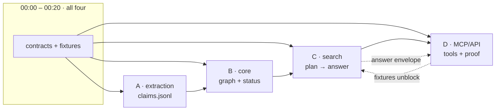

# 10 — Workstreams: four developers, four lanes

Four lanes, one owner each, one contract between them. This supersedes the workstream
section of [08](08-delivery-plan.md#workstreams) where they disagree. Scope is frozen by
[ADR-0006](adr/0006-scope-of-the-build.md): four pipelines, six intents, three MCP tools.

Budget: 4 × 5 h = 20 developer-hours, ~14 productive. Freeze at **03:30**, not 03:45.
The pure layers (contracts, compiler, resolver functions, fixtures) are built **before**
the event, so day-of work is wiring — that is what buys the slack, not moving a clock.

## The four lanes

| Lane | Owner | Owns | Never touches |
|---|---|---|---|
| **Extraction** | Dev A | `apps/context-service/ingest/` | `graph/`, `retrieval/`, `api/` |
| **Core** | Dev B | `apps/context-service/graph/`, `infra/neo4j/` | `ingest/`, `retrieval/`, `api/` |
| **Search** | Dev C | `apps/context-service/retrieval/` | `ingest/`, `graph/`, `api/` |
| **MCP / API** | Dev D | `apps/context-service/api/`, `apps/context-service/mcp_server.py`, `tests/golden/`, `data/fixtures/` | the three above |

Boundary rule: a cross-lane change is a message to the owner, not a commit. The only
shared artefacts are the four contracts below; both sides of a contract change together
or not at all.

## The four contracts (frozen 00:00–00:20, all four present)

Each contract already has a defining section; the freeze only turns prose into code.
Anchor lines were re-checked on 2026-11-06.

| Contract | Defined by | State |
|---|---|---|
| `models/claim.py` — `ClaimRecord` + `Span` (built) | [05:6-40](05-extraction-pipelines.md#one-envelope-six-pipelines--four-ship) | text complete: referential `Span` (no persisted excerpt), `valid_from_precision` / `valid_to_precision` |
| `contracts/cqp.schema.json` | [06:39-85](06-retrieval.md#the-cqp-schema) | six intents, `IMPACT_OF_CHANGE` removed |
| `models/answer.py` — `Answer` (built) | [06:122-166](06-retrieval.md#answer-assembly) | citations are `{path, lines, hash}`; text resolved by `/v1/span` |
| `infra/neo4j/schema.cypher` | [03:157-192](03-ontology.md#storage-indexing-and-validation-in-neo4j) | Community-safe: uniqueness only, non-null in code |

Plus one artefact that buys the parallelism: `data/fixtures/claims-sample.jsonl`,
30 hand-written claims covering T1 and T2. Dev C and Dev D develop against it from
minute 20; without it they wait two hours for Dev A.

**Three fields the review added to the contracts, all frozen:**

- `valid_from_precision` / `valid_to_precision` (`day` | `month`), because
  `releases/2026-06-v1.3.md` yields `2026-06`. Rule: `valid_from` → first day of the
  period, `valid_to` → last day ([04](04-temporal-model.md#partial-dates-one-rule-both-edges-safe)).
- `Span` is **referential**: `path`, `start_line`, `end_line`, `content_hash`. The excerpt
  is transient verification input and is never persisted; answer citations carry the same
  four fields and the text is resolved by `/v1/span`.
- `schema.cypher` uses **uniqueness constraints only** — property existence is Enterprise
  Edition in Neo4j 5, and we run `neo4j:5-community`. Non-null lives in pydantic and in a
  loader assertion that raises.

## Lane detail

### A · Extraction — `ingest/`

Owns the walker, the router and the deterministic pipelines. Works entirely on files;
never opens Neo4j.

- **00:20–01:00** Walker (`git ls-files` + content hash), router (path → extension →
  magic bytes), `ConfigPipeline` (`package.json`, `compose.yaml`, `config/ports.json`,
  `pnpm-workspace.yaml`, `turbo.json`, `CODEOWNERS`). No tree-sitter, no VLM: the
  `CodePipeline` and `DiagramPipeline` are forward work ([ADR-0006](adr/0006-scope-of-the-build.md)).
- **01:00–02:00** `SchemaPipeline` (`sqlglot`): migration-ordered validity —
  `002-account-tiers.sql` closes `users.status`, opens `users.account_status`.
- **02:00–03:00** `NarrativePipeline` **header pass only** — `Date:`, `Status:`,
  bylines, filename dates, `api-specs/history/` and `archive/` path rules. No model.
- **03:00–03:30** integration fixes against the loader.

**Gate 2 is A's responsibility and it needs a mechanism, not a hope.** Chunks handed to
any model must carry line numbers, and the record must be produced as
`excerpt + start_line`; the pipeline derives `end_line` from the match offset. Excerpt
absent → drop the claim and count it.

**Done when** `uv run ncs ingest` writes `data/local/claims.jsonl` and
`uv run python -m ingest.audit data/local/claims.jsonl` prints every record passing
gates 1–3, including the `users.status → account_status` rename from the real migration.

### B · Core — `graph/` + `infra/neo4j/`

Owns the store, the loader and every decision about what is currently true.

- **00:20–00:50** Neo4j up on all four laptops; `schema.cypher` applied; edition
  decision recorded in the compose file comment.
- **00:50–01:50** Loader: `MERGE` on the derived claim id, `DERIVED_FROM`,
  `EVIDENCED_BY`, idempotent re-runs.
- **01:50–03:00** Temporal resolver steps 1–7 (`04`): score, explicit supersession,
  negation, prohibition, ranking, ties, corroboration. Pure functions over a list of
  claims — testable without Neo4j, so it is unit-tested against T1 by 02:30.
- **03:00–03:30** Conflict detection (`CONTRADICTS`, both sides kept) and L2
  materialisation of only the claims that survived.

**Owns the edition risk.** If Community is the only option on the demo machine, the
fallback is already decided above; nobody discovers it live.

**Done when** `uv run ncs resolve` turns fixtures + ingested claims into a graph where
T1 answers `DEPRECATED` for the wiki claim with `valid_to=2026-06-04`, and running the
loader twice leaves the node count unchanged.

### C · Search — `retrieval/`

Owns the only path from a question to the database. Highest risk, longest chain, so
**the compiler and the six templates are written before the event** — they need no
corpus, no Neo4j and no model, and writing them on the day is what puts the freeze at
risk.

- **Pre-event** `cqp.schema.json`, the validator, the six compiler templates, the
  assembler. Unit tests with hand-written plans as fixtures.
- **00:20–01:20** Embeddings (`nomic-embed-text`, 768-d) over chunks; hybrid seed —
  vector kNN + BM25 → RRF (k=60). No cross-encoder: it is not in the five-hour build,
  and the recall target gets set for the pipeline that actually ships.
- **01:20–02:40** Wire plan → compile → execute → assemble against the real graph.
  Planner failures degrade to hybrid-only with `degraded: true` — never a guess.
- **02:40–03:30** Token budget + ordering (`06`), `conflicts` and `gaps` in the
  envelope, latency measured warm.

**Done when** `uv run pytest tests/cqp` is green with no model running, and
`curl -s localhost:8000/v1/plan -d '{"question":"does inventory use redis?"}'` returns a
valid CQP with `intent=STATE_OF`.

### D · MCP / API — `api/`, `mcp_server.py`, `tests/golden/`, `data/fixtures/`

Owns the two transports, the proof, and the demo.

- **00:20–01:00** Fixtures (30 claims, T1 + T2), the acceptance envelope, and a REST
  skeleton answering from fixtures — so the demo shape exists at 01:00 regardless of
  what the graph can do.
- **01:00–02:00** `ContextService` service layer; `/v1/query`, `/v1/plan`, `/v1/execute`,
  `/v1/entity/{kind}/{key}`.
- **02:00–03:00** MCP server, **three** tools: `context_search`,
  `context_explain_relationship`, `context_risks` (plus the shared `resolve_span`
  helper). Six were designed; three ship, and that is said out loud.
- **03:00–03:30** Golden set of seven traps, three assertions each (answer, status,
  citation). Freeze at 03:30 whether or not all seven are green; the run is the report.

**Done when** `uv run pytest tests/golden -v` prints seven rows and the MCP server
answers `context_search` from Claude Code with citations.

## Dependency graph

Only A→B and B→C are real waits, and both consume a **file**, not a running service.
C's pre-built compiler means its wait starts at 01:20, not at 00:20.

## Checkpoints

| Time | Gate | Fails if |
|---|---|---|
| 00:20 | Contracts loaded from the pre-event build, fixtures on disk, Neo4j up | anyone still designing an interface |
| 02:00 | One pipeline → graph → `/v1/query` answers T1 from real data | the path is still fixture-only |
| 03:30 | Feature freeze; golden set run and printed | someone is mid-refactor |
| 03:30–04:15 | Rehearsal on the demo machine | rehearsal starts on a laptop |
| 04:15 | Demo | — |

Column 3 of the scope line ([08](08-delivery-plan.md#scope-line)) is a slide, not a
branch. Anything unfinished is stashed and described as forward work.

## Who owns which review finding

All five blockers are **resolved and frozen** ([ADR-0006](adr/0006-scope-of-the-build.md)).

| Finding | Resolution |
|---|---|
| Pack §3/§4 unknown | Deliverable fixed as the seven-trap demo + repo + explained design; §4 outranks this and is re-diffed at CP1 02:00 if it surfaces |
| Zero-slack critical path | Pure layers built before the event: compiler + six templates + tests (C), answer schema + 30 claims (D), resolver functions + T1 test (B) |
| Gate 2 mechanism unspecified | Extractors return `excerpt` + `start_line` as a hint; the gate resolves it against the file at its hash, derives `end_line`, drops on absence, counts `span_corrected` |
| Month-precision dates | `valid_from` → day 1, `valid_to` → last day, precision recorded on the claim |
| Neo4j Enterprise-only constraints | `neo4j:5-community`, uniqueness only, non-null enforced in pydantic + loader assertion |
| 6 vs 3 tools | Three ship, three remain CQP intents behind `/v1/query` |
| Reranker cut but still drawn | Removed from `06`; recall target set for hybrid + RRF |
| Spine vs design indistinguishable | ADR-0006 is the scope SSOT; `08` scope line rewritten; pipelines marked *forward* in `02`/`05` |
| `06` cited app.py:41-58 | Corrected to 61-85 in the answer example |
