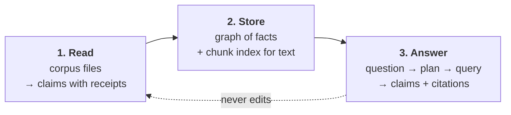

# 11 — How the pipeline works, in plain words

This is the friendly tour. It explains the same system as [02](02-architecture.md) and
[06](06-retrieval.md), with less vocabulary. Where they disagree, **they** are right and
this page is a bug.

## The one rule

> An answer is only an answer if it can show you the file and line it came from.

Nothing below is decoration. Every part of the pipeline exists to make that rule cheap to
obey and hard to break.

## The three boxes



The arrows only go one way. Reading never asks the store anything, answering never writes
to it, and the corpus is read-only input (`AGENTS.md` invariant 1).

## Box 1 — Read: turn files into claims

A walk yields every text file in the corpus with a content hash (`sources.py::iter_files`).
Each file goes to whichever *pipeline* says it recognises that kind of file
(`ingest/registry.py:156`):

| Pipeline | What it recognises | What it emits |
|---|---|---|
| `SqlAlter` | `ALTER TABLE … RENAME COLUMN a TO b` | `a` is no longer a column; `b` is |
| `JsonConfigMap` | a JSON object of name → value | `service LISTENS_ON 5005` |
| `MarkdownStatus` | `Date:` / `Status:` headers | a document's claim about itself |

A *claim* is one small statement, not a paragraph. It carries: who it is about, what the
relation is, when it was observed, and one or more **spans** — `path`, `start_line`,
`end_line`, `content_hash`. The excerpt text itself is not stored. It is re-read from disk
when needed, so the graph can never drift from the repository.

That is the whole trick: **the claim is a pointer plus a tiny fact, not a quotation.**

Two design notes worth knowing:

- Deterministic first. A regex over `Status:`, a path convention, an AST node — if a fact
  can be read exactly, it is read exactly. A model that re-reads what a parser already knows
  is slower, costs electricity, and is more likely wrong (`ADR-0005`).
- The span gate. A claim whose excerpt is not literally at its cited lines is dropped, never
  repaired (invariant 7). Today the deterministic pipelines derive the line from the match
  position, so they cannot guess; the gate becomes the thing that protects *model-authored*
  claims when that lands (`ingest/gates.py`, on the other branch).

## Box 2 — Store: two different things, for two different jobs

The store holds two layers on purpose:

1. **Facts** — `Claim`, `Span`, `Entity`, `Source` nodes. Small, exact, cited.
2. **Chunks** — the same corpus cut into ~2000-character windows with heading paths, plus
   one 768-number vector each (`graph/chunks.py`). Big, fuzzy, rebuildable.

Chunks exist so a question in different words can still find the right file. They are never
cited and never treated as facts. Delete them any time; `cli index` rebuilds them.

Before anything is written, `graph/resolver.py::resolve` decides what each claim *means*:

| Label | Plain meaning |
|---|---|
| `VALID` | believed now, within its dates |
| `DEPRECATED` | it was true, something replaced it |
| `PROPOSED` | planned, not done |
| `PLANNED` | scheduled with a date |
| `DISPUTED` | two claims disagree and both keep their citation |
| `UNKNOWN` | we do not have enough to say |

Contradictions never delete a row. The loser stays in the graph wearing a label, because
"this used to be true and here is the proof" is an answer, while silence is not.

## Box 3 — Answer: question → plan → query → envelope

```
question
  → plan            one of six intents, anchors, time filter   (retrieval/planner.py)
  → validate        closed schema, bounded numbers              (retrieval/cqp.py)
  → compile         one of six parameterised Cypher templates   (retrieval/cqp.py)
  → execute         read-only against Neo4j
  → assemble        dedupe, rank, verify every citation by hash (retrieval/service.py)
  → envelope        answer + claims + conflicts + gaps + degraded
```

The six intents are `LOOKUP`, `STATE_OF`, `RELATIONSHIP`, `CONFLICTS`, `TIMELINE`, `RISKS`
(`retrieval/cqp.py:25`). A question is mapped to one of them; each maps to exactly one
query template. **The model never writes Cypher** (invariant 8). It may only choose an
intent and name the things being asked about, and even that is deterministic first: the
keyword planner answers in ~10 ms and a model is consulted only when a question names
nothing it can anchor.

Then the answer is checked the way a human would check it: for every claim, read the span
back off disk, hash it, compare. A citation that fails verification is dropped with a
note in `gaps`. If a whole layer is unavailable — no vectors, no model, no graph rows — the
answer gets smaller and says so with `degraded: true`, instead of sounding equally certain.

Two transports, one service:

| Surface | What it is for |
|---|---|
| `POST /v1/query` | the answer envelope |
| `POST /v1/plan` | the plan, unexecuted — for debugging trust |
| `GET /v1/span` | the literal bytes behind a citation |
| MCP `context_search`, `context_explain_relationship`, `context_risks`, `resolve_span` | the same service, for agents |

## Why not just embeddings?

Point a vector search at the corpus, paste the best chunk into a model, done. That fails on
this corpus *by construction*: the files contain removed features, renamed columns,
superseded API versions, an archived service sharing a name, a rejected proposal, and a
disputed incident. The most topically similar chunk is usually the stale one
([01](01-corpus-survey.md)).

So retrieval is used for **finding**, and the graph is used for **deciding**. Seven fixed
questions encode the traps; all seven must pass with the right label and the right citation
(`tests/golden/test_traps.py`). They are the definition of "it works", not a smoke test.

## Running it

```sh
make up        # Neo4j (Community, 768-d vector index)
make extract   # corpus -> data/local/claims-extracted.jsonl
make load      # fixtures + extracted claims -> graph
make index     # chunks -> graph, with embeddings when Ollama answers
make serve     # REST on :8000
make test      # whole suite, seven traps included
make rehearse  # cold start, 12 checks, prints "rehearsal: READY"
```

Everything is local: Neo4j in Docker, `nomic-embed-text` for vectors, `llama3.2` optional
as a planner fallback ([local-model.md](local-model.md)). With no model at all, retrieval
degrades to lexical search and the answer says `degraded`.

The same pipeline runs entirely in containers — `etyt-neo4j`, `etyt-ollama` and `etyt-app`,
with the corpus mounted read-only:

```sh
make docker-up     # neo4j + ollama + app in containers
make docker-demo   # pull the model, then the pipeline inside etyt-app
make docker-index  # re-chunk inside etyt-app (embeds via etyt-ollama)
```

`etyt-app` talks to Neo4j as `neo4j` / `etyt-context`; the Neo4j browser is on
`http://127.0.0.1:7474` and the API stays on `http://127.0.0.1:8000`. Ollama is CPU-only
here (no nvidia runtime), so embeddings are slow but present.

## What is honestly not built yet

- Only three extractors exist. YAML config and the `api-specs/history` / `archive` path
  rules are still hand-written fixtures — they are the difference between "demo works" and
  "pipeline works", and they are issues `01` and `02`.
- The excerpt gate for model-authored claims lives on `feat/quality-filter`; `main` has the
  invariant and the deterministic equivalent, not the module.
- Two parallel implementations of the same app exist (`main` and that branch). Land it in
  pieces, not wholesale — issue `06`, [consensus.md](consensus.md).
